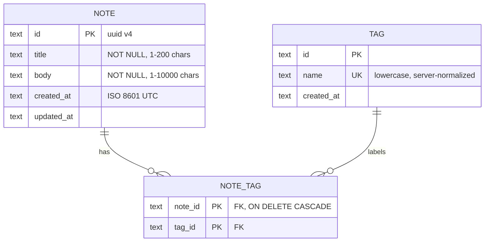

# 01 — Notes App · Solution

> **Spoiler.** Attempt your own ERD and contract first — the struggle is the exercise. Compare your choices against these; if yours differ but you can defend them, you passed.

## Assumptions

Stated explicitly, because each one shapes the schema:

1. Single user, no auth, no sharing. Nothing in the data model needs an `owner_id`.
2. "Title and some text": `title` is required (1–200 chars), `body` is required (1–10 000 chars). An empty note is meaningless.
3. "Tags are short lowercase words": the server normalizes tags — trims, lowercases, rejects anything outside `^[a-z0-9][a-z0-9-]{0,31}$`. Clients can't create `Todo` vs `todo` duplicates.
4. "It should just be gone": **hard delete**, no soft-delete column. (Requirement is explicit; adding `deleted_at` would be speculative.)
5. "Newest first" is by `created_at` (creation order, not activity), with `id` as a deterministic tiebreak.
6. A note may have zero tags; a tag may exist with zero notes (tags are independent entities — they have rename/delete endpoints).
7. "Search by word" = case-insensitive substring match over title + body. Full-text search is out of scope at this scale.
8. Pagination: `limit`/`offset`, `limit` capped at 100. Justified for a single-user dataset; projects 03+ switch to cursor pagination.

## Data model



Why a join table and not a tag array column on `notes`: requirement 8 (rename a tag, every note updates) is a single `UPDATE tags` with a join table; with an array/CSV column it becomes a scan-and-rewrite of every note containing the tag — and the uniqueness of tag names lives nowhere.

## Schema (DDL — runs on SQLite; Postgres needs only type swaps)

```sql
CREATE TABLE notes (
  id         TEXT PRIMARY KEY,              -- uuid, generated app-side
  title      TEXT NOT NULL CHECK (length(title) BETWEEN 1 AND 200),
  body       TEXT NOT NULL CHECK (length(body) BETWEEN 1 AND 10000),
  created_at TEXT NOT NULL,                 -- ISO 8601 UTC
  updated_at TEXT NOT NULL
);

CREATE TABLE tags (
  id         TEXT PRIMARY KEY,
  name       TEXT NOT NULL UNIQUE,          -- already lowercase-normalized
  created_at TEXT NOT NULL
);

CREATE TABLE note_tags (
  note_id TEXT NOT NULL REFERENCES notes(id) ON DELETE CASCADE,
  tag_id  TEXT NOT NULL REFERENCES tags(id)  ON DELETE RESTRICT,
  PRIMARY KEY (note_id, tag_id)
);

CREATE INDEX idx_notes_created ON notes(created_at DESC, id DESC);  -- list sort
CREATE INDEX idx_note_tags_tag ON note_tags(tag_id);                -- filter by tag
```

Deliberate choices: `ON DELETE CASCADE` for note→join rows (deleting a note cleans up); `ON DELETE RESTRICT` for tag→join rows (deleting a tag with notes is a `409 conflict`, not silent unlinking — you asked for delete, so it refuses while in use; `ON DELETE CASCADE` here would silently orphan the "delete" semantics).

## API contract

### Endpoint map

| Method | Path | Success | Errors |
|---|---|---|---|
| GET | `/notes?q=&tag=&limit=&offset=` | `200` NoteList (empty list if no match) | `400 invalid_param` |
| POST | `/notes` | `201` Note + `Location` | `422 validation_failed` |
| GET | `/notes/{noteId}` | `200` Note | `404 not_found` |
| PATCH | `/notes/{noteId}` | `200` Note | `404`, `422 validation_failed` |
| DELETE | `/notes/{noteId}` | `204` no body | `404` |
| PUT | `/notes/{noteId}/tags` | `200` Note (replaces whole tag set) | `404`, `422` |
| DELETE | `/notes/{noteId}/tags/{tagId}` | `200` Note | `404` |
| GET | `/tags` | `200` TagList | — |
| PATCH | `/tags/{tagId}` | `200` Tag (rename) | `404`, `409 tag_name_taken`, `422` |
| DELETE | `/tags/{tagId}` | `204` | `404`, `409 tag_in_use` |

**Error envelope** (defined once, `$ref`'d everywhere):

```json
{ "error": { "code": "validation_failed", "message": "title must be 1-200 characters", "details": { "field": "title" } } }
```

### OpenAPI

```yaml
openapi: 3.1.0
info: { title: Notes API, version: 1.0.0 }
paths:
  /notes:
    get:
      summary: List notes, newest first
      parameters:
        - { name: q,    in: query, schema: { type: string, maxLength: 100 },
            description: "Case-insensitive substring match on title+body" }
        - { name: tag,  in: query, schema: { type: string },
            description: "Tag NAME (normalized) to filter by" }
        - { name: limit,  in: query, schema: { type: integer, default: 50, maximum: 100 } }
        - { name: offset, in: query, schema: { type: integer, default: 0, minimum: 0 } }
      responses:
        "200":
          description: A page of notes; empty data list when nothing matches
          content:
            application/json:
              schema: { $ref: "#/components/schemas/NoteList" }
    post:
      summary: Create a note (tags optional, created by name)
      requestBody:
        required: true
        content:
          application/json:
            schema: { $ref: "#/components/schemas/NoteInput" }
      responses:
        "201":
          description: Created
          content: { application/json: { schema: { $ref: "#/components/schemas/Note" } } }
        "422": { $ref: "#/components/responses/ValidationError" }
  /notes/{noteId}:
    parameters: [ { $ref: "#/components/parameters/NoteId" } ]
    get:
      responses:
        "200": { description: OK, content: { application/json: { schema: { $ref: "#/components/schemas/Note" } } } }
        "404": { $ref: "#/components/responses/NotFound" }
    patch:
      requestBody:
        required: true
        content:
          application/json:
            schema: { $ref: "#/components/schemas/NotePatch" }
      responses:
        "200": { description: Updated, content: { application/json: { schema: { $ref: "#/components/schemas/Note" } } } }
        "404": { $ref: "#/components/responses/NotFound" }
        "422": { $ref: "#/components/responses/ValidationError" }
    delete:
      responses:
        "204": { description: Deleted permanently }
        "404": { $ref: "#/components/responses/NotFound" }
  /notes/{noteId}/tags:
    parameters: [ { $ref: "#/components/parameters/NoteId" } ]
    put:
      summary: Replace the note's entire tag set (idempotent)
      requestBody:
        required: true
        content:
          application/json:
            schema:
              type: object
              required: [tags]
              properties:
                tags: { type: array, maxItems: 20, items: { type: string } }
      responses:
        "200": { description: New tag set, $ref Note }
        "404": { $ref: "#/components/responses/NotFound" }
        "422": { $ref: "#/components/responses/ValidationError" }
  /tags/{tagId}:
    patch:
      requestBody:
        required: true
        content:
          application/json:
            schema:
              type: object
              required: [name]
              properties: { name: { type: string } }
      responses:
        "200": { description: Renamed everywhere }
        "404": { $ref: "#/components/responses/NotFound" }
        "409":
          description: Another tag already has that name
          content: { application/json: { schema: { $ref: "#/components/schemas/Error" } } }
    delete:
      responses:
        "204": { description: Deleted (only when unused) }
        "404": { $ref: "#/components/responses/NotFound" }
        "409": { description: Tag still attached to notes, content: { application/json: { schema: { $ref: "#/components/schemas/Error" } } } }
components:
  parameters:
    NoteId: { name: noteId, in: path, required: true, schema: { type: string, format: uuid } }
  responses:
    NotFound:
      description: Resource does not exist
      content: { application/json: { schema: { $ref: "#/components/schemas/Error" } } }
    ValidationError:
      description: Request body failed validation
      content: { application/json: { schema: { $ref: "#/components/schemas/Error" } } }
  schemas:
    Error:
      type: object
      required: [error]
      properties:
        error:
          type: object
          required: [code, message]
          properties:
            code: { type: string }
            message: { type: string }
            details: { type: object, additionalProperties: true }
    Note:
      type: object
      required: [id, title, body, tags, created_at, updated_at]
      properties:
        id: { type: string, format: uuid }
        title: { type: string }
        body: { type: string }
        tags: { type: array, items: { $ref: "#/components/schemas/Tag" } }
        created_at: { type: string, format: date-time }
        updated_at: { type: string, format: date-time }
    NoteInput:
      type: object
      required: [title, body]
      properties:
        title: { type: string, minLength: 1, maxLength: 200 }
        body: { type: string, minLength: 1, maxLength: 10000 }
        tags: { type: array, maxItems: 20, items: { type: string } }
    NotePatch:
      description: Absent fields are kept; the request must contain at least one field
      type: object
      minProperties: 1
      properties:
        title: { type: string, minLength: 1, maxLength: 200 }
        body: { type: string, minLength: 1, maxLength: 10000 }
    NoteList:
      type: object
      required: [data, total, limit, offset]
      properties:
        data: { type: array, items: { $ref: "#/components/schemas/Note" } }
        total: { type: integer }
        limit: { type: integer }
        offset: { type: integer }
    Tag:
      type: object
      required: [id, name]
      properties:
        id: { type: string, format: uuid }
        name: { type: string }
```

## Design decisions, answered

| Decision | Choice | Why (and what the alternative costs) |
|---|---|---|
| Tags: join table vs array column | Join table | Rename = one `UPDATE tags`. Array column makes tag names non-normalized data scattered across notes; uniqueness unenforceable. |
| Tag name case | Normalize to lowercase on write | "Tags are short lowercase words" in the brief; `UNIQUE` then means what users expect. |
| `PUT /notes/{id}/tags` (replace) vs per-tag POST/DELETE | Replace, plus a single-tag DELETE | Replace is idempotent and matches "these are the tags"; the single DELETE covers the common one-off case without the client resending everything. |
| Tag that loses its last note | Persists | Tags are independent entities (req 8 gives them CRUD); garbage-collecting them would fight explicit creation. |
| DELETE note | Hard delete, `204` empty | Brief says gone, no trash. `204` because there is nothing to say back. |
| "Newest first" | `created_at DESC, id DESC` | Creation order matches "newest"; the `id` tiebreak makes the ordering stable across pages. |
| Search misses | `200` with empty list | Search is a filter, not an address. `404` is for a *resource path* that doesn't exist. |
| Unknown tag id in PUT | `404 not_found` | Auto-create applies to tag *names* (req 7). A well-formed but unknown id is a client bug; silent auto-creation would mask it. |
| `updated_at` semantics | Set on any successful PATCH/PUT | "Updated" reflects the row, not the body content; checking for no-op writes is not worth the complexity at this scale. |
| Lost update (two clients PATCH) | Last write wins, documented | Correct at single-user scale; optimistic locking (`If-Match`/ETag) is the upgrade path, noted in the contract description. |

## Back-of-the-envelope

- Volume: 20 notes/day × 2 KB ≈ **15 MB/year** — the dataset fits in memory for its entire useful life.
- Search: `LIKE '%q%'` can't use an index, but a full scan of 50k notes × 2 KB ≈ 100 MB is still < 100 ms on SQLite. Full-text (FTS5) becomes worth it around ~10⁵–10⁶ notes.
- The `idx_notes_created` index covers the list sort (no filesort); `idx_note_tags_tag` covers tag filtering without touching `notes` first.
- Offset pagination is safe here: the dataset is tiny and single-writer. The moment this goes multi-user, switch to cursor (project 03's pattern).

## Gotchas, resolved

- **Case-duplicate tags**: impossible by construction — server normalizes before lookup/insert.
- **Deleting a tag in use**: `409 tag_in_use` (FK is `RESTRICT`), forcing the client to detach first. Deliberate friction, not an accident.
- **Search matching nothing**: `200` + `{"data": [], "total": 0}`.
- **Lost update**: last-write-wins, stated in the contract description. A stated default beats an unstated assumption.

## Self-review bar

Every user story maps to exactly one primary endpoint; every 4xx has a body and a machine code; the DDL runs as-is on SQLite; the join table exists *because of requirement 8*, not because "many-to-many feels right".
