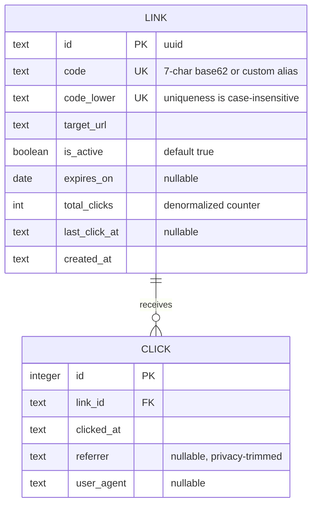

# 02 — URL Shortener · Solution

> **Spoiler.** Commit to your own design first, then compare. The redirect status code and the click-storage choice are where this project is won or lost.

## Assumptions

1. Single operator; all links belong to "the operator" (auth arrives in project 03).
2. Generated codes: 7 characters from `[a-zA-Z0-9]` (base62), random, server-generated. Custom aliases additionally allow `-`.
3. Alias matching is **case-insensitive** for uniqueness (`Abc` and `abc` collide) — users perceive them as the same; the original casing is preserved for display.
4. Click privacy: **no IP addresses stored**. Referrer and user-agent are stored; this is stated in the contract so it's a decision, not an accident.
5. Per-day stats retention: 90 days of raw click rows, then purged (aggregates remain in the counters).
6. URL validation: must parse, scheme must be `http`/`https`, host required, max 2048 chars. Stored byte-exact (fragments, query, unicode preserved).
7. Error responses on the redirect endpoint are JSON bodies (browsers show the JSON; a human-friendly page is a rendering concern, not a contract concern).

## Data model



## Schema (DDL — SQLite)

```sql
CREATE TABLE links (
  id           TEXT PRIMARY KEY,
  code         TEXT NOT NULL,
  code_lower   TEXT NOT NULL,             -- lower(code), for case-insensitive uniqueness
  target_url   TEXT NOT NULL CHECK (length(target_url) <= 2048),
  is_active    INTEGER NOT NULL DEFAULT 1,
  expires_on   TEXT,                      -- 'YYYY-MM-DD', nullable = never
  total_clicks INTEGER NOT NULL DEFAULT 0,
  last_click_at TEXT,
  created_at   TEXT NOT NULL
);
CREATE UNIQUE INDEX idx_links_code_lower ON links(code_lower);

CREATE TABLE clicks (
  id         INTEGER PRIMARY KEY,         -- SQLite rowid; Postgres: BIGSERIAL
  link_id    TEXT NOT NULL REFERENCES links(id) ON DELETE CASCADE,
  clicked_at TEXT NOT NULL,
  referrer   TEXT,
  user_agent TEXT
);
CREATE INDEX idx_clicks_link_time ON clicks(link_id, clicked_at);
```

Reserved aliases (`api`, `health`, `admin`, `stats`, `r`, `links`, `static`, `assets`) are enforced in application logic — a `CHECK` with a hardcoded list doesn't belong in the schema for something that changes.

## API contract

### Endpoint map

| Method | Path | Success | Errors |
|---|---|---|---|
| POST | `/links` | `201` Link | `409 alias_taken`, `409 alias_reserved`, `422 invalid_url`, `422 invalid_alias`, `422 invalid_expiry` |
| GET | `/links?limit=&cursor=` | `200` LinkList | `400 invalid_cursor` |
| GET | `/links/{code}` | `200` Link | `404` |
| PATCH | `/links/{code}` | `200` Link (activate/deactivate/edit expiry) | `404`, `422` |
| GET | `/links/{code}/stats?days=` | `200` Stats | `404` |
| GET | `/r/{code}` | `302` + `Location` header, no body | `404 not_found` (unknown **or** deactivated), `410 link_expired` |

### The redirect endpoint, modeled properly

```yaml
  /r/{code}:
    get:
      summary: Redirect to the target URL
      description: |
        Returns 302 (not 301) deliberately: 301 is cacheable, and a cached redirect
        never reaches this server again — every one of those visits is missing from
        the stats. The extra round trip is the price of truthful analytics.
      parameters:
        - { name: code, in: path, required: true, schema: { type: string, maxLength: 64 } }
      responses:
        "302":
          description: Temporary redirect to the target
          headers:
            Location:
              description: The original target URL, byte-exact
              schema: { type: string, format: uri }
            Cache-Control:
              description: "no-store: proxies must not cache the redirect either"
              schema: { type: string }
        "404":
          description: Unknown code, or code deactivated (deliberately indistinguishable)
          content: { application/json: { schema: { $ref: "#/components/schemas/Error" } } }
        "410":
          description: Link expired per expires_on
          content: { application/json: { schema: { $ref: "#/components/schemas/Error" } } }
```

Note the pattern: the redirect lives under `/r/` so the JSON API namespace (`/links`) and the public short-URL namespace never collide — a custom alias could otherwise shadow an API path.

## Design decisions, answered

| Decision | Choice | Why |
|---|---|---|
| Code generation | Random base62, length 7, `UNIQUE` + retry | Sequential codes are enumerable (scrape every link); random at this length makes collisions negligible (math below). Retry-on-collision against the unique index is the *only* correct mechanism — checking-then-inserting races. |
| Redirect status | `302` + `Cache-Control: no-store` | `301` permanently caches in browsers/proxies → those clicks never register → stats lie. `307` would be defensible; `302` is the conventional "moved temporarily". |
| Clicks: rows vs counter | **Both** — one row per click (truth) + `total_clicks`/`last_click_at` counters on the link | Rows answer "clicks per day" and any future segmentation; counters make the hot stat O(1). Counter-only would lose per-day; rows-only would aggregate on every stats read, forever. |
| Counter update synchronous? | Same transaction as the click insert | At this scale (math below) the write is cheap; async queueing would make stats eventually-consistent for no real gain. Stated as revisitable at ~1k redirects/s. |
| Expiry vs deactivation | Expired → `410 link_expired`; deactivated → `404`, byte-identical to unknown | Expiry is a scheduled, truthful property. Deactivation should be indistinguishable from "never existed" — a deactivated code that still answers differently is still *leaking state*. |
| Expiry boundary | A link is usable through the whole `expires_on` date in **UTC**; first visit after that fails | Timezone math in the contract, not in a code comment. |
| Click privacy | Referrer + user-agent stored; no IP | Stated in the contract. "We store nothing" is equally valid — the failure is not deciding. |
| Alias charset | `[a-zA-Z0-9-]`, case-insensitive uniqueness via `code_lower` | Users type aliases into browsers, where host paths are case-sensitive — the `code_lower` unique index is what makes "the same alias" mean one link. |

## Back-of-the-envelope

**Code space & collisions.** `62^7 ≈ 3.52 × 10^12` possible codes. Birthday-collision expectation for `n` links in a space of `N`: `n²/2N`. At 10k new links/day for 10 years (n ≈ 3.65 × 10⁷):

```
(3.65e7)² / (2 × 3.52e12) ≈ 190 collisions over a decade
```

~190 retry loops in ten years — the `UNIQUE` index absorbs this invisibly. (This is also why the code is 7 and not 5 chars: at 5 chars, `62^5 ≈ 9.2 × 10^8`, the same decade produces ~700k collisions — still *correct*, but the retry loop gets warm.)

**Traffic.** 10k new links/day, average 100 redirects/link/day → ~1M redirects/day ≈ **12/s average, ~100/s peak**. A single SQLite/Postgres node handles this asleep; the two writes per redirect (click row + counter) are the whole cost.

**Storage.** Click row ≈ 150–250 B → 1M/day ≈ 200 MB/day; the 90-day retention keeps the live clicks table ≈ **18 GB**, bounded forever. Without the purge decision, this table is the one that eats the disk — which is exactly why the retention number had to be a stated assumption.

**Stats queries.** `total` and `last_click` read two columns from one row (O(1)). The daily series is one indexed range scan `(link_id, clicked_at)` over ≤ 90 days of that link's rows.

## Gotchas, resolved

- **Alias casing**: uniqueness on `code_lower`; `Abc` after `abc` → `409 alias_taken`.
- **Reserved codes**: application-level check → `409 alias_reserved` (listed in the contract so clients know it's permanent).
- **Byte-exact targets**: URL stored as a raw string, never re-serialized through a URL library; `Location` header echoes it exactly.
- **Expiry timezone**: `expires_on` interpreted in UTC, documented on the parameter.
- **Bot traffic**: in scope and counted — excluding bots is a product decision (UA filtering), noted as out of scope in the contract rather than silently half-done.
- **Zero-click days**: the daily series is dense (0-filled for the requested range) — clients shouldn't have to zip sparse arrays against a calendar.

## Self-review bar

Collision handling rests on the constraint, not the retry loop's politeness; you can explain what `301` would have done to the stats; every non-302 outcome of `GET /r/{code}` has a status, a body, and a reason; the clicks table has a growth ceiling because you wrote a retention number down.
