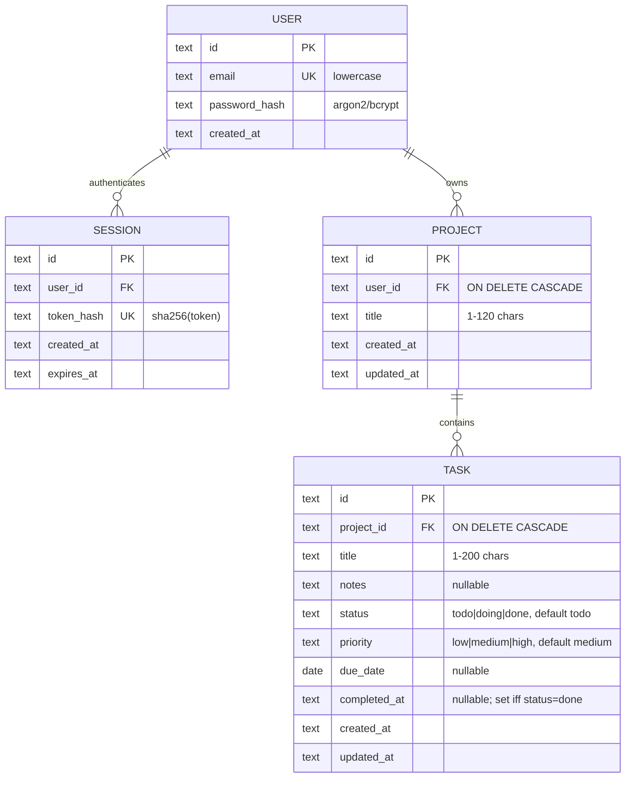

# 03 — Todo Manager with Projects · Solution

> **Spoiler.** Commit first. The 401/403/404 policy and the PATCH semantics are the two places where vague contracts breed client bugs.

## Assumptions

1. Auth: email + password registration, opaque **session tokens** (32 random bytes, only their SHA-256 hash stored), sent as `Authorization: Bearer <token>`. JWTs are unnecessary at this scale — a session row is revocable and needs no crypto to get right.
2. **The isolation rule**: with a valid token, any resource you don't own returns `404`, byte-identical to a nonexistent one. `403` never appears for ownership — only a `403` can confirm existence to an attacker. `401` is reserved for missing/invalid credentials.
3. Priority is an enum (`low|medium|high`), not an int — ints invite "what does 3 mean" debates into the contract.
4. Status transitions (the complete map, enforced server-side):

   | From → To | Allowed via |
   |---|---|
   | `todo → doing` | PATCH |
   | `doing → todo` | PATCH |
   | `doing → done` | PATCH or `POST /complete` |
   | `todo → done` | `POST /complete` only |
   | `done → todo` | PATCH (reopen; clears `completed_at`) |
   | `done → doing` | **never** — reopen goes through `todo` |

5. `POST /tasks/{id}/complete` on an already-`done` task is **idempotent**: `200` with the task. The action's goal ("make it done") is already satisfied.
6. PATCH semantics: **absent field = keep**; explicit `null` clears a nullable field (`due_date`, `notes`). Written on every PATCH endpoint description.
7. "This week": the API offers explicit `due_from`/`due_to` date filters (client decides what a week is) plus a convenience `overdue=true`. All dates are **UTC calendar dates** — a per-user timezone is out of scope until the data model carries one.
8. Pagination: cursor from this project onward (`limit`/`cursor`), because task lists are the first collection that plausibly grows unboundedly.
9. Deleting a project cascades its tasks (DB-level), and `DELETE /projects/{id}` returns `204` — the client asked for deletion, not a report.

## Data model



## Schema (DDL — SQLite; Postgres: `TEXT`→`UUID`/`TIMESTAMPTZ`)

```sql
CREATE TABLE users (
  id            TEXT PRIMARY KEY,
  email         TEXT NOT NULL UNIQUE,     -- normalized lowercase at write time
  password_hash TEXT NOT NULL,
  created_at    TEXT NOT NULL
);

CREATE TABLE sessions (
  id         TEXT PRIMARY KEY,
  user_id    TEXT NOT NULL REFERENCES users(id) ON DELETE CASCADE,
  token_hash TEXT NOT NULL UNIQUE,
  created_at TEXT NOT NULL,
  expires_at TEXT NOT NULL
);

CREATE TABLE projects (
  id         TEXT PRIMARY KEY,
  user_id    TEXT NOT NULL REFERENCES users(id) ON DELETE CASCADE,
  title      TEXT NOT NULL CHECK (length(title) BETWEEN 1 AND 120),
  created_at TEXT NOT NULL,
  updated_at TEXT NOT NULL
);
CREATE INDEX idx_projects_user ON projects(user_id, created_at DESC, id DESC);

CREATE TABLE tasks (
  id           TEXT PRIMARY KEY,
  project_id   TEXT NOT NULL REFERENCES projects(id) ON DELETE CASCADE,
  title        TEXT NOT NULL CHECK (length(title) BETWEEN 1 AND 200),
  notes        TEXT,
  status       TEXT NOT NULL DEFAULT 'todo'
               CHECK (status IN ('todo','doing','done')),
  priority     TEXT NOT NULL DEFAULT 'medium'
               CHECK (priority IN ('low','medium','high')),
  due_date     TEXT,
  completed_at TEXT,
  created_at   TEXT NOT NULL,
  updated_at   TEXT NOT NULL,
  CHECK ((status = 'done') = (completed_at IS NOT NULL))
);
CREATE INDEX idx_tasks_project ON tasks(project_id, status, created_at DESC, id DESC);
```

The last `CHECK` is the schema-level piece of the state machine: `completed_at` is set **if and only if** status is `done` — the two can never disagree, whatever the application layer does.

## API contract

### Endpoint map

| Method | Path | Success | Errors |
|---|---|---|---|
| POST | `/auth/register` | `201` User | `422 validation_failed`, `409 email_taken` |
| POST | `/auth/login` | `200` `{token, expires_at}` | `401 invalid_credentials` (same response for unknown email — no existence leak) |
| POST | `/auth/logout` | `204` (revokes the session) | `401` |
| GET | `/me` | `200` User | `401` |
| GET / POST | `/projects` | `200`/`201` | `401`, `422` |
| GET / PATCH / DELETE | `/projects/{projectId}` | `200`/`200`/`204` | `401`, `404` (foreign or unknown), `422` |
| GET / POST | `/projects/{projectId}/tasks?status=&sort=&limit=&cursor=` | `200`/`201` | `401`, `404`, `400 invalid_sort`, `400 invalid_cursor`, `422` |
| GET | `/tasks?due_from=&due_to=&overdue=&sort=&limit=&cursor=` | `200` TaskList (cross-project) | `401`, `400` |
| GET / PATCH / DELETE | `/tasks/{taskId}` | `200`/`200`/`204` | `401`, `404`, `422 invalid_transition`, `422 validation_failed` |
| POST | `/tasks/{taskId}/complete` | `200` Task (idempotent) | `401`, `404` |

### Sorting & pagination contract

- `sort` is a comma-separated list from a fixed whitelist: `created_at`, `due_date`, `priority`; prefix `-` for descending. Example: `?sort=-priority,due_date`. Unknown fields → `400 invalid_sort` (never silently ignored).
- Every sort is made stable by the hidden tiebreak `(id ASC)`.
- Cursor: opaque base64 of `{created_at, id}` of the last row; response carries `next_cursor` (`null` = end). Garbage cursor → `400 invalid_cursor`.

### OpenAPI (the load-bearing parts)

```yaml
openapi: 3.1.0
info:
  title: Todos API
  version: 1.0.0
  description: |
    Ownership is invisible: any foreign or unknown resource returns the same 404.
    PATCH semantics: absent fields are kept, explicit null clears nullable fields.
components:
  securitySchemes:
    bearerAuth: { type: http, scheme: bearer, description: "Session token from /auth/login" }
  schemas:
    TaskStatus:  { type: string, enum: [todo, doing, done] }
    TaskPriority: { type: string, enum: [low, medium, high] }
    Task:
      type: object
      required: [id, project_id, title, status, priority, created_at, updated_at]
      properties:
        id: { type: string, format: uuid }
        project_id: { type: string, format: uuid }
        title: { type: string }
        notes: { type: [string, "null"] }
        status: { $ref: "#/components/schemas/TaskStatus" }
        priority: { $ref: "#/components/schemas/TaskPriority" }
        due_date: { type: [string, "null"], format: date }
        completed_at: { type: [string, "null"], format: date-time }
        created_at: { type: string, format: date-time }
        updated_at: { type: string, format: date-time }
    TaskPatch:
      type: object
      minProperties: 1
      description: "Absent = keep. null clears notes/due_date."
      properties:
        title: { type: string, minLength: 1, maxLength: 200 }
        notes: { type: [string, "null"] }
        status: { $ref: "#/components/schemas/TaskStatus" }
        priority: { $ref: "#/components/schemas/TaskPriority" }
        due_date: { type: [string, "null"], format: date }
paths:
  /auth/login:
    post:
      security: []
      requestBody:
        required: true
        content:
          application/json:
            schema:
              type: object
              required: [email, password]
              properties: { email: { type: string }, password: { type: string } }
      responses:
        "200":
          description: Session token
          content:
            application/json:
              schema:
                type: object
                required: [token, expires_at]
                properties: { token: { type: string }, expires_at: { type: string, format: date-time } }
        "401":
          description: Bad credentials — identical for unknown email and wrong password
          content: { application/json: { schema: { $ref: "#/components/schemas/Error" } } }
  /tasks/{taskId}/complete:
    post:
      security: [{ bearerAuth: [] }]
      summary: Mark done; sets completed_at. Idempotent when already done.
      responses:
        "200": { description: The task, status=done }
        "401": { $ref: "#/components/responses/Unauthorized" }
        "404": { $ref: "#/components/responses/NotFound" }
  /tasks/{taskId}:
    patch:
      security: [{ bearerAuth: [] }]
      description: |
        Status transitions allowed here: todo->doing, doing->todo, doing->done,
        done->todo (reopen, clears completed_at). done->doing is rejected.
        todo->done must use POST /tasks/{id}/complete.
      requestBody: { required: true, content: { application/json: { schema: { $ref: "#/components/schemas/TaskPatch" } } } }
      responses:
        "200": { description: Updated task }
        "422":
          description: invalid_transition | validation_failed
          content: { application/json: { schema: { $ref: "#/components/schemas/Error" } } }
```

## Design decisions, answered

| Decision | Choice | Why |
|---|---|---|
| 403 vs 404 for foreign resources | `404`, always | `403` confirms existence. The isolation rule is applied uniformly, so clients can't probe ids. |
| Unknown email at login | `401`, identical body to wrong password | Same leak, same fix. |
| Enum storage | `CHECK` constraints + OpenAPI `enum`; a migration test asserts they match | Two sources of truth are inevitable (DB + contract); a test is how they stay one truth. |
| Complete: endpoint vs PATCH | Dedicated endpoint for `→ done`; PATCH handles the rest | Completion stamps `completed_at` and is the app's central gesture; a named action documents itself, and the transition map stays small. |
| Complete on done | `200`, idempotent | Retries happen; a state-satisfying action shouldn't error on replay. |
| Cascade delete | `ON DELETE CASCADE`, `204` response | DB-enforced (no app-level loop to forget); the brief explicitly wants tasks gone. |
| Pagination | Cursor (`created_at, id` tiebreak) | Cheap to adopt now; offset breaks when rows are inserted between pages. Project 09 formalizes this same format. |
| "Due this week" | Explicit `due_from`/`due_to` params, UTC dates | The server shouldn't guess the client's calendar or timezone; explicit params are self-documenting. |
| PATCH semantics | Absent = keep, `null` = clear | The ambiguity that generates the most client bugs; written into the spec description and enforced consistently. |

## Back-of-the-envelope

- 1 000 users × 50 tasks = **50 000 task rows** (~10 MB). Nothing here stresses any index; the indexes exist for the *shape* of the queries (project filter + status; user's cross-project scan) — and the `(created_at, id)` tail of each index is what the cursor walks.
- "My week": with `idx_tasks_project` the cross-project query is per-project range scans; at this scale a single `tasks` index on `(due_date)` added for the week query is equally fine — say which you chose.
- Login rate: trivial; `token_hash` lookup is one indexed point query. Sessions expiry is a lazy check at auth time (expired = `401`), no sweeper needed.

## Gotchas, resolved

- **Byte-identical 404s**: one code path produces the body for "unknown" and "foreign" — tested by comparing literal response bytes.
- **`"status": "Done"`** → `422 validation_failed` (the enum is exact-match, lowercase; case-insensitive acceptance would be a second, undocumented contract).
- **Complete on completed** → `200` idempotent (decision 5).
- **Overdue in "my week"** → `overdue=true` is `due_date < today AND status != 'done'`; overdue tasks appear in week results only if their `due_date` falls inside the requested range — filters compose, they don't merge.
- **Create-task race with project delete** → the FK rejects the insert (`FOREIGN KEY constraint failed` → surfaced as `404 project_not_found`); no orphan tasks possible.

## Self-review bar

The transition map is a table, not vibes; 401/404/422 have a written policy; the `completed_at ⟷ status` invariant lives in the schema; every list endpoint specifies sort whitelist, tiebreak, and cursor format.
