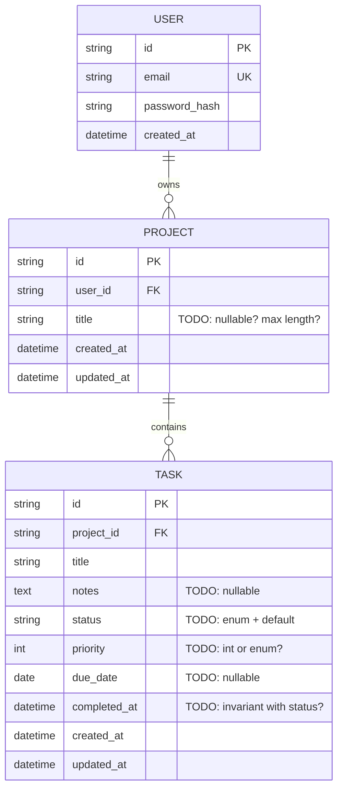

# 03 — Todo Manager with Projects and Users

Difficulty ★★ · Focus: auth in the contract · ownership & authorization · filtering/sorting/pagination · PATCH semantics · enums & state transitions

Expected effort: one to two sessions. Builds on [01](01-notes-app.md), [02](02-url-shortener.md).

## The brief

> "A small task app for a few people with accounts. Each person has projects; projects hold tasks. A task has a status — to do, doing, or done — an optional due date, and a priority. Everyone only sees their own stuff; I shouldn't even be able to tell that other people's projects exist. I want to see the tasks of one project, or all my tasks due this week across all projects. Completing a task is a distinct action, not just an edit — it stamps when it was done. Deleting a project takes its tasks with it."

## Requirements (user stories)

1. Register (email + password) and log in; get a token. Log out.
2. See who I am (`GET /me`).
3. Create, list, rename, delete my projects.
4. Create, list, edit, delete tasks inside a project. Fields: title, optional notes, status (`todo|doing|done`), priority (1–5 or `low|medium|high` — you pick), optional due date.
5. **Isolation**: another user requesting my project's id gets `404` — not `403`, not a leak that it exists.
6. List a project's tasks filtered by status, sorted by due date / priority / creation (pick the param contract).
7. "My week": all my tasks across all projects that are due within a date range, or overdue.
8. `POST /tasks/{id}/complete` — a dedicated action: sets status `done` and `completed_at`.
9. Un-completing is possible, and clears `completed_at`. But you can't complete an already-completed task... or can you? Decide.
10. Deleting a project deletes its tasks. The response says what happened.

## Design decisions to resolve

- **Auth in the contract**: bearer token via OpenAPI `securitySchemes`. Where does the token live (header? `Authorization: Bearer`)? What do `401` (who are you) and `403` (I know you, no) each mean here — and given requirement 5, when does `403` ever occur?
- **Enum storage**: `CHECK` constraint in the DB + `enum` in OpenAPI. How do the two stay in sync? What happens when a client sends `Status: "Done"`?
- **Complete as an endpoint vs `PATCH status=done`**: what does the dedicated action buy you (validation, `completed_at`, audit)? Define the full allowed-transition map: which status changes are legal, which return `422 invalid_transition`?
- **Sorting contract**: `?sort=due_date&order=asc` vs `?sort=-due_date`. Pick one. What's the default sort? Is the tiebreak stable?
- **Pagination**: offset or cursor? At this scale either works — but justify it, because project 09 will force the other one.
- **PATCH semantics**: absent field = keep, or absent = clear? (This one ambiguity causes more client bugs than any other. Write the rule into the spec description.)
- "Due this week": which timezone? The server's? The user's? Where is that boundary in the contract?
- Cascade delete: DB `ON DELETE CASCADE` vs application-level? What does `DELETE /projects/{id}` return — `204`? A body with counts?
- Dates: `due_date` is a date (no time), `completed_at` is a timestamp. Does the API ever accept a datetime for a due date, and what do you truncate to?

## Starter ERD



## Suggested API surface (react to it, don't obey it)

- `POST /auth/register`, `POST /auth/login`, `POST /auth/logout`
- `GET /me`
- `GET /projects`, `POST /projects`, `GET/PATCH/DELETE /projects/{projectId}`
- `GET /projects/{projectId}/tasks`, `POST /projects/{projectId}/tasks`
- `GET /tasks?scope=week` — cross-project "my week" (or nest it under `/me` — decide)
- `GET/PATCH/DELETE /tasks/{taskId}`
- `POST /tasks/{taskId}/complete`

## OpenAPI skeleton

```yaml
openapi: 3.1.0
info:
  title: Todos API
  version: 0.1.0
components:
  securitySchemes:
    bearerAuth:            # TODO: describe where the token comes from
      type: http
      scheme: bearer
  schemas:
    Error: {}              # TODO: house envelope
    TaskStatus:
      type: string
      enum: [todo, doing, done]   # TODO: does the API ever accept other casing?
paths:
  /auth/login:
    post:
      # TODO: request, 200 with token, 401 bad credentials
      #       (401 or 404 for unknown email — which, and why?)
      security: []
      responses: {}
  /projects/{projectId}/tasks:
    get:
      security: [{ bearerAuth: [] }]
      # TODO: filters (status), sort, pagination
      # TODO: 404 (project unknown OR not yours — same response, deliberately)
      responses: {}
    post:
      security: [{ bearerAuth: [] }]
      # TODO: 201 | 422 validation (what exactly is invalid?)
      responses: {}
  /tasks/{taskId}:
    patch:
      security: [{ bearerAuth: [] }]
      # TODO: partial update semantics written in the description
      # TODO: can status change here? or only via /complete? decide, then spec it
      responses: {}
  /tasks/{taskId}/complete:
    post:
      security: [{ bearerAuth: [] }]
      # TODO: 200 with the task | 422 invalid_transition (already done?)
      responses: {}
```

## Gotchas to test

- User A's token against user B's task id → `404`, identical body to "doesn't exist". Verify byte-for-byte.
- `PATCH` with `{"status": "Done"}` → what, exactly? (`422` with which `code`?)
- `POST /tasks/{id}/complete` on an already-completed task → `200` idempotent, or `422`? Decide and defend.
- Task with `due_date` in the past and status `todo` — does "my week" include it? (Overdue rule.)
- Deleting a project while another request is creating a task in it — race. What *should* happen, what *will* happen?

## Self-review checklist

- [ ] `securitySchemes` declared; every non-auth endpoint requires auth in the spec — not just in your head.
- [ ] The 401 / 403 / 404 boundary is written down and applied consistently.
- [ ] Transition rules for `status` are explicit (a small table in your notes is fine).
- [ ] Every list endpoint defines filter, sort, and pagination — or documents why it has none.
- [ ] The DDL runs; `status` has a CHECK; `completed_at`'s relationship to `status` is enforced somewhere.
