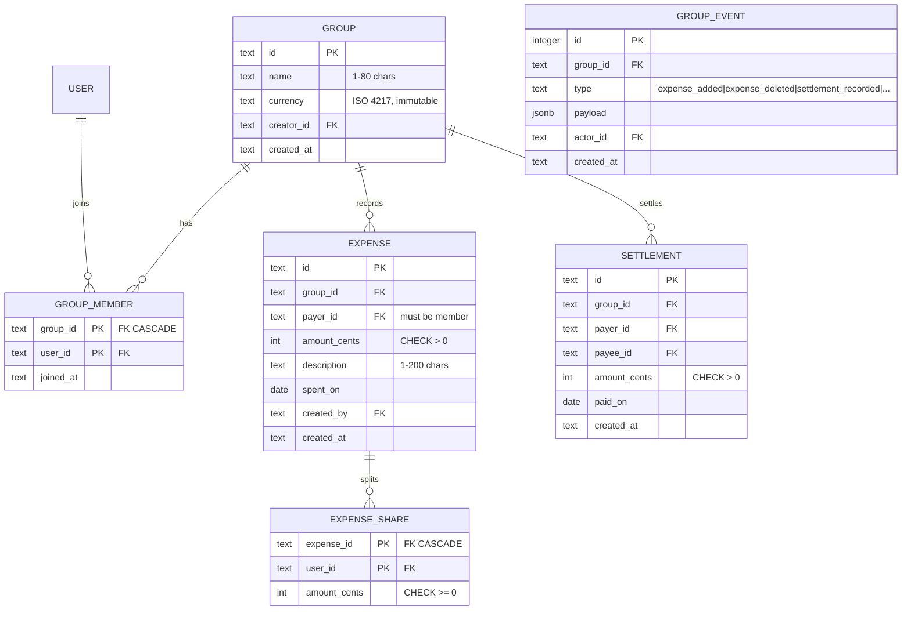

# 04 — Expense Splitter · Solution

> **Spoiler.** Commit first. The share-sum invariant and the "compute or store balances" decision are the heart of this project.

## Assumptions

1. Auth is inherited from project 03 (users, sessions, bearer tokens). Only membership in a group grants any access to it — non-members get `404`, per the house isolation rule.
2. One currency per group, set at creation, **immutable** (changing it would corrupt historical amounts).
3. All money is integer cents (`amount_cents`), `> 0` for expenses, `≥ 0` for shares.
4. **Equal-split remainder rule**: `base = floor(amount/n)`; the leftover `r = amount − base·n` cents go to the first `r` participants **ordered by `user_id`** (ascending). Deterministic, documented, and it guarantees `Σ shares = amount` exactly.
5. The payer *may* be excluded from shares (paying on behalf of others) and *may* be included — the schema permits both.
6. Anyone in the group may add expenses; only the **payer** (or the group creator) may edit/delete one, and only while no settlement has been recorded after it — after that, edits distort settled history, so it's `409 expense_settled`.
7. Settlements are independent ledger entries — they never reference an expense. Editing/deleting an expense re-derives balances correctly; overpayment is allowed and simply creates a credit in the other direction.
8. Removing a member with a nonzero balance → `409 member_has_balance`. (Forcing settlement first is the point of the app.)
9. Balances are **computed on read** (a view), never stored — see the decision table for why.

## Data model



## Schema (DDL — Postgres; SQLite works with trigger syntax changes)

```sql
CREATE TABLE groups (
  id         UUID PRIMARY KEY DEFAULT gen_random_uuid(),
  name       TEXT NOT NULL CHECK (length(name) BETWEEN 1 AND 80),
  currency   CHAR(3) NOT NULL,
  creator_id UUID NOT NULL REFERENCES users(id),
  created_at TIMESTAMPTZ NOT NULL DEFAULT now()
);

CREATE TABLE group_members (
  group_id  UUID NOT NULL REFERENCES groups(id) ON DELETE CASCADE,
  user_id   UUID NOT NULL REFERENCES users(id),
  joined_at TIMESTAMPTZ NOT NULL DEFAULT now(),
  PRIMARY KEY (group_id, user_id)
);

CREATE TABLE expenses (
  id          UUID PRIMARY KEY DEFAULT gen_random_uuid(),
  group_id    UUID NOT NULL REFERENCES groups(id) ON DELETE CASCADE,
  payer_id    UUID NOT NULL REFERENCES users(id),
  amount_cents BIGINT NOT NULL CHECK (amount_cents > 0),
  description TEXT NOT NULL CHECK (length(description) BETWEEN 1 AND 200),
  spent_on    DATE NOT NULL,
  created_by  UUID NOT NULL REFERENCES users(id),
  created_at  TIMESTAMPTZ NOT NULL DEFAULT now()
);
CREATE INDEX idx_expenses_group ON expenses(group_id, spent_on);

CREATE TABLE expense_shares (
  expense_id   UUID NOT NULL REFERENCES expenses(id) ON DELETE CASCADE,
  user_id      UUID NOT NULL REFERENCES users(id),
  amount_cents BIGINT NOT NULL CHECK (amount_cents >= 0),
  PRIMARY KEY (expense_id, user_id)
);

CREATE TABLE settlements (
  id           UUID PRIMARY KEY DEFAULT gen_random_uuid(),
  group_id     UUID NOT NULL REFERENCES groups(id) ON DELETE CASCADE,
  payer_id     UUID NOT NULL REFERENCES users(id),
  payee_id     UUID NOT NULL REFERENCES users(id),
  amount_cents BIGINT NOT NULL CHECK (amount_cents > 0),
  paid_on      DATE NOT NULL,
  created_at   TIMESTAMPTZ NOT NULL DEFAULT now(),
  CHECK (payer_id <> payee_id)
);
CREATE INDEX idx_settlements_group ON settlements(group_id);

CREATE TABLE group_events (
  id         BIGINT GENERATED ALWAYS AS IDENTITY PRIMARY KEY,
  group_id   UUID NOT NULL REFERENCES groups(id) ON DELETE CASCADE,
  type       TEXT NOT NULL,
  payload    JSONB NOT NULL,
  actor_id   UUID NOT NULL REFERENCES users(id),
  created_at TIMESTAMPTZ NOT NULL DEFAULT now()
);
CREATE INDEX idx_events_group ON group_events(group_id, id DESC);
```

**The invariant — `Σ shares = expense.amount` — enforced below the app:**

```sql
CREATE FUNCTION assert_shares_sum() RETURNS trigger AS $$
DECLARE total BIGINT; expected BIGINT;
BEGIN
  SELECT COALESCE(SUM(amount_cents), 0) INTO total
    FROM expense_shares WHERE expense_id = COALESCE(NEW.expense_id, OLD.expense_id);
  SELECT amount_cents INTO expected
    FROM expenses WHERE id = COALESCE(NEW.expense_id, OLD.expense_id);
  IF total <> expected THEN
    RAISE EXCEPTION 'shares do not sum to expense amount';
  END IF;
  RETURN NULL;
END $$ LANGUAGE plpgsql;

CREATE CONSTRAINT TRIGGER trg_shares_sum
  AFTER INSERT OR UPDATE OR DELETE ON expense_shares
  DEFERRABLE INITIALLY DEFERRED FOR EACH ROW EXECUTE FUNCTION assert_shares_sum();
```

Deferred so a transaction may insert the expense row and all shares, and the check runs at commit — partial states never escape the transaction.

**Balances: a view, the single source of arithmetic:**

```sql
CREATE VIEW group_balances AS
WITH movements AS (
  -- payer is owed the whole expense...
  SELECT e.group_id, e.payer_id AS user_id, e.amount_cents AS delta
  FROM expenses e
  UNION ALL
  -- ...minus everyone's own share (including the payer's)
  SELECT e.group_id, s.user_id, -s.amount_cents
  FROM expense_shares s JOIN expenses e ON e.id = s.expense_id
  UNION ALL
  -- settlements: payer's debt shrinks (+), payee's shrinks (−)
  SELECT group_id, payer_id,  amount_cents FROM settlements
  UNION ALL
  SELECT group_id, payee_id, -amount_cents FROM settlements
)
SELECT group_id, user_id, SUM(delta) AS balance_cents
FROM movements
GROUP BY group_id, user_id;
```

Convention: **positive = the group owes this member**. Written into the endpoint description.

## API contract

### Endpoint map

| Method | Path | Success | Errors |
|---|---|---|---|
| POST / GET | `/groups` | `201`/`200` | `422` |
| GET / PATCH / DELETE | `/groups/{groupId}` | `200`/`200`/`204` | `404` (foreign/unknown) |
| POST | `/groups/{groupId}/members` | `200` Group | `404`, `409 already_member` |
| DELETE | `/groups/{groupId}/members/{userId}` | `204` | `404`, `409 member_has_balance` |
| GET / POST | `/groups/{groupId}/expenses` | `200`/`201` | `404`, `422 shares_do_not_sum`, `422 unknown_member`, `422 not_a_member` |
| GET / PATCH / DELETE | `/expenses/{expenseId}` | `200`/`200`/`204` | `404`, `403 not_payer`, `409 expense_settled` |
| GET | `/groups/{groupId}/balances` | `200` | `404` |
| GET | `/groups/{groupId}/suggested-settlements` | `200` | `404` |
| POST | `/groups/{groupId}/settlements` | `201` | `404`, `422 self_settlement`, `422 unknown_member` |
| GET | `/groups/{groupId}/feed?limit=&cursor=` | `200` | `404` |

### OpenAPI (the load-bearing parts)

```yaml
openapi: 3.1.0
info:
  title: Expense Splitter API
  version: 1.0.0
paths:
  /groups/{groupId}/expenses:
    post:
      requestBody:
        required: true
        content:
          application/json:
            schema:
              oneOf:
                - title: Equal split
                  type: object
                  required: [payer_id, amount_cents, description, spent_on, split]
                  properties:
                    payer_id: { type: string, format: uuid }
                    amount_cents: { type: integer, minimum: 1 }
                    description: { type: string, maxLength: 200 }
                    spent_on: { type: string, format: date }
                    split:
                      type: object
                      required: [mode, member_ids]
                      properties:
                        mode: { type: string, enum: [equal] }
                        member_ids: { type: array, minItems: 1, items: { type: string, format: uuid } }
                - title: Exact amounts
                  properties:
                    split:
                      type: object
                      required: [mode, shares]
                      properties:
                        mode: { type: string, enum: [exact] }
                        shares:
                          type: array
                          minItems: 1
                          items:
                            type: object
                            required: [user_id, amount_cents]
                            properties:
                              user_id: { type: string, format: uuid }
                              amount_cents: { type: integer, minimum: 0 }
      responses:
        "201": { description: Expense with resolved shares }
        "422":
          description: shares_do_not_sum | unknown_member | payer_not_member | not_a_member
          content: { application/json: { schema: { $ref: "#/components/schemas/Error" } } }
  /groups/{groupId}/balances:
    get:
      description: |
        Positive balance = the group owes this member. Computed live from
        expenses + settlements; ordering is by balance descending, user_id ascending.
      responses:
        "200":
          content:
            application/json:
              schema:
                type: object
                properties:
                  data:
                    type: array
                    items:
                      type: object
                      required: [user_id, balance_cents]
                      properties:
                        user_id: { type: string, format: uuid }
                        balance_cents: { type: integer }
  /groups/{groupId}/suggested-settlements:
    get:
      description: |
        Greedy pairwise netting (max debtor ↔ max creditor). Near-minimal transfer
        count, NOT provably minimal. Deterministic: ties broken by user_id.
      responses:
        "200":
          content:
            application/json:
              schema:
                type: object
                properties:
                  data:
                    type: array
                    items:
                      type: object
                      properties:
                        from_user_id: { type: string, format: uuid }
                        to_user_id: { type: string, format: uuid }
                        amount_cents: { type: integer, minimum: 1 }
```

## Design decisions, answered

| Decision | Choice | Why |
|---|---|---|
| Sum invariant | DB constraint trigger (deferred) + app validation for a friendly `422` | The app check gives a good error; the trigger is what makes the invariant true even when a bug bypasses the app. Both layers, different jobs. |
| Balances: compute vs store | **Compute** (view) on read | Write the aggregation query first (done above) and see the cost: a group's movements are a few hundred rows even after years — the "cached balance" buys nothing here and adds a consistency liability. Revisit only if a group accumulates 10⁵+ movements. |
| Settlements: special expense vs own table | Own table | A settlement isn't "an expense someone paid for" — it has two parties and no shares. Folding it into expenses would force the share invariant (`Σ = amount`) into a shape it doesn't fit. The view makes both feed one arithmetic. |
| Expense edited/deleted after settlements | Allowed (settlements are independent) | Balances re-derive correctly by construction — this is the payoff of not storing balances and not linking settlements to expenses. |
| Remainder cents | First `r` participants by `user_id` | Any deterministic rule works; an *undocumented* rule breaks the sum invariant the moment two code paths split differently. |
| Who edits/deletes | Payer (or creator); frozen once settlements postdate it | Protects the meaning of money people already settled against; `409` beats silent history rewriting. |
| Overpayment | Allowed — creates a reverse credit | Real friendships have rounding and goodwill; rejecting it adds a rule with no safety payoff. The arithmetic handles it for free. |
| Remove member with balance | `409 member_has_balance` | The balance *is* the reason they're in the app; removal without settlement erases real debt. |
| Suggested settlements | Greedy netting, documented as near-minimal | Provably minimal transfer sets are a flow problem (min-cost max-flow) — overkill. Documenting the approximation is the honest contract. |
| Feed | Append-only `group_events` written in the same tx as mutations | Derived-on-read can't reconstruct *intent* (who did it, when) cleanly; event rows are cheap and also give the cursor a natural sort key. Project 08 takes this further. |

## Back-of-the-envelope

- A group of 8 with 30 expenses/month for 5 years: 1 800 expenses, ~10 000 share rows, ~500 settlements. The balance view aggregates ≈ 12 000 rows **per read** — sub-millisecond with `idx_expenses_group`. Storing balances would save nothing measurable and cost a reconciliation path.
- Money integrity: integers + the remainder rule mean `Σ shares = amount` holds to the cent, always; the trigger makes a violation impossible rather than unlikely.
- Suggested-settlements cost: O(m log m) over the members with nonzero balance (≤ group size) — nothing.
- Feed: one indexed range scan per page (`(group_id, id DESC)` cursor).

## Gotchas, resolved

- **100 cents / 3 people** → 34/33/33 with the extra cents to the two lowest `user_id`s — same output on every code path, tested.
- **Payer not in shares** (lent money) → legal; the view credits the payer the full amount and debits only the listed sharers.
- **Cross-group leakage**: every query is rooted at `group_id`; balances are computed per group in the view (`GROUP BY group_id`) — leakage is structurally impossible, not filtered out.
- **Overpay settlement** → `201`; balances flip sign naturally.
- **Concurrent edits to one expense** → last-write-wins on the expense row, but shares are *replaced wholesale* inside the write transaction, so the sum invariant can't be violated by interleaving.

## Self-review bar

The invariant is enforced in the database, and you can name what breaks first without it; the balance convention (positive = owed to) is written in the contract; every arithmetic path (edit, delete, settle, overpay) walks through one view; the remainder rule is deterministic and tested.
