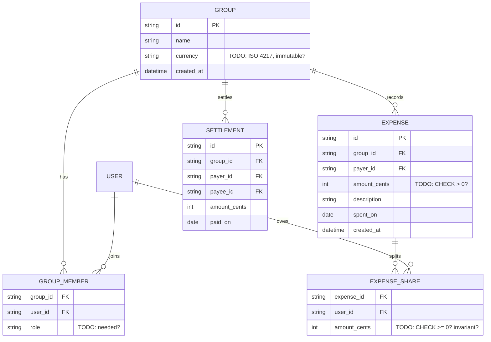

# 04 — Expense Splitter (Splitwise-lite)

Difficulty ★★★ · Focus: derived data (balances) · many-to-many with attributes · money integrity · split invariants

Expected effort: two sessions. Builds on [03](03-todo-projects.md) (auth, ownership).

## The brief

> "Groups of friends track shared expenses. Whoever paid records an expense: amount, description, date, and who it's for. Usually everyone in the group splits it equally, but sometimes only some members are included, or shares are uneven. Each member wants to see their balance in the group — what they're owed, or what they owe, and to whom. Even better: the simplest set of payments that would settle everyone up. Paying someone back is recorded too, and shrinks the debts. One currency per group, set when the group is created."

## Requirements (user stories)

1. Create a group; it has a name and a currency. Members join (you may reuse users from project 03).
2. Add/remove members. (Can you remove one with a nonzero balance? Decide.)
3. Add an expense: payer, amount (integer cents), description, date, and a split — either *equal among chosen members* or *exact amounts*.
4. Equal split must divide fairly: a `10.00` expense among 3 people can't be 3.33×3. Define a deterministic remainder rule (who absorbs the extra cent).
5. Invariant: shares always sum to the expense amount. Exactly. Enforced somewhere.
6. Edit or delete an expense — payer only? anyone? What if settlements already happened around it?
7. Balances per member: net of "paid for others" minus "owes for others". Derived from expenses + settlements.
8. Suggested settlements: the minimal set of payments that zeroes all balances (a greedy algorithm is acceptable — say so in the contract).
9. Record a settlement: payer, payee, amount. Reduces the corresponding balances.
10. Activity feed: recent events in the group (expense added, settlement recorded…).

## Design decisions to resolve

- **The shares table** is the heart of this project: `expense_shares(expense_id, user_id, amount_cents)`. The invariant `SUM(shares) = expense.amount_cents` — enforced by a DB trigger/constraint, application code, or both? What corrupts if it's only app-level?
- **Balances: compute or store?** Write the aggregation query first (expenses' shares minus settlements), look at it, then decide whether to also maintain a materialized balances table. What's the failure mode of a cached balance? What's the cost of always computing?
- **Settlements as a special expense vs their own table** — trace each option through the balance math. How does "expense edited after someone settled" behave in each?
- Money is integer cents + currency code on the group. No floats anywhere. What breaks if someone sneaks a float in?
- Who may edit/delete an expense — and can you delete one that a settlement "replied" to? Is the answer different for the payer vs. a group admin?
- Removing a member with a nonzero balance: block it (`409`), force settlement first, or reassign their shares? Pick one.
- The suggested-settlements endpoint is a *computed* resource: `GET /groups/{id}/suggested-settlements`. Is it stable run-to-run? Does the contract promise an ordering?
- The feed: an append-only `events` table written alongside mutations, or derived from history on read? (Compare with project 08, where you'll be forced to store events.)

## Starter ERD



## Suggested API surface (react to it, don't obey it)

- `POST /groups`, `GET /groups` (mine), `GET/PATCH/DELETE /groups/{groupId}`
- `POST /groups/{groupId}/members`, `DELETE /groups/{groupId}/members/{userId}`
- `GET /groups/{groupId}/expenses`, `POST /groups/{groupId}/expenses`
- `GET/PATCH/DELETE /expenses/{expenseId}`
- `GET /groups/{groupId}/balances`
- `GET /groups/{groupId}/suggested-settlements`
- `POST /groups/{groupId}/settlements`
- `GET /groups/{groupId}/feed`

## OpenAPI skeleton

```yaml
openapi: 3.1.0
info:
  title: Expense Splitter API
  version: 0.1.0
paths:
  /groups/{groupId}/expenses:
    post:
      # TODO: body — payer, amount_cents, description, spent_on,
      #       split: {mode: equal, member_ids: [...]} | {mode: exact, shares: [{user_id, amount_cents}]}
      # TODO: 201 | 422 shares_do_not_sum | 422 unknown_member | 403 not_a_member
      responses: {}
  /groups/{groupId}/balances:
    get:
      # TODO: computed resource — response {balances: [{user_id, balance_cents}]}
      #       positive = owed, negative = owes — write that convention into the description
      responses: {}
  /groups/{groupId}/suggested-settlements:
    get:
      # TODO: [{from_user_id, to_user_id, amount_cents}]
      #       document: greedy approximation, ordering unspecified?
      responses: {}
  /groups/{groupId}/settlements:
    post:
      # TODO: 201 | 422 amount_exceeds_debt? (decide whether that's even an error)
      responses: {}
components:
  schemas:
    Error: {}   # TODO: house envelope; add codes: shares_do_not_sum, member_has_balance, ...
```

## Gotchas to test

- Expense of 100 cents among 3: your remainder rule produces 34/33/33 — in a *deterministic, documented* order. Test it.
- An expense where the payer is not among the share-holders (lent money to two friends only) — legal? Your schema should allow it.
- A user in two groups with the same currency — balances must never leak across groups.
- Settlement of more than the current debt — allowed (credit) or rejected (`422`)? Both are defensible; only silence isn't.
- Two members editing the same expense concurrently — lost update again. Acceptable? Document.

## Self-review checklist

- [ ] `SUM(expense_shares.amount_cents) = expenses.amount_cents` is enforced — say where (DB vs app) and what happens if the other layer is bypassed.
- [ ] Balance math survives: edit an expense, delete an expense, delete a settlement — walk each through your query.
- [ ] Zero floats in the schema; currency lives on the group, never on the expense… unless you decided otherwise, in writing.
- [ ] The computed endpoints (`balances`, `suggested-settlements`) specify their ordering and stability.
- [ ] Membership removal with outstanding balance is impossible — by which mechanism?
