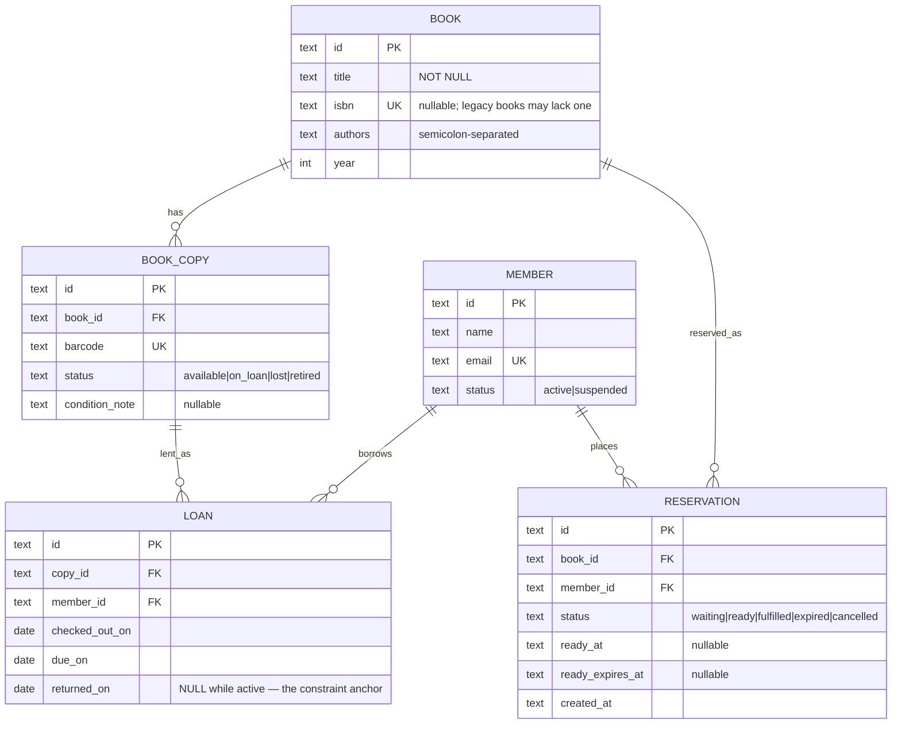

# 05 — Library / Rental System · Solution

> **Spoiler.** Commit first. Book-vs-copy, the one-active-loan-per-copy constraint, and the ready-reservation lifecycle are where this project is decided.

## Assumptions

1. Two roles call the API: **staff** (checkout, return, catalog/inventory management, member management) and **members** (self-service: reserve, cancel own reservation, view own loans). Auth inherits project 03; `role` lives on the user. Cross-role access → `403`; unknown/foreign resource → `404` per house rule.
2. A **book** (title) and a **copy** (physical item) are separate entities. Loans reference copies; reservations reference books. "Available" is a property of a copy; "reservable" is a property of a book.
3. Loan period: 14 days, `due_on = checkout date + 14` (calendar days, server-local date — the library's timezone is the library's business, one stated clock).
4. Rules and their error codes (each rule, one code):

   | Rule | Violation |
   |---|---|
   | Max 5 active loans per member | `422 loan_limit_reached` |
   | No checkout with any overdue loan | `422 member_overdue` |
   | Suspended members can't check out | `422 member_suspended` |
   | Copy must not be on loan/lost/retired | `409 copy_not_available` |
   | Copy held for a ready reservation → only that member may take it | `409 copy_reserved_for_pickup` |
   | Can't reserve a title you currently have on loan | `422 title_on_loan_to_you` |
   | Can't reserve while a copy is available | `422 copies_available` |
   | Retiring a copy that's on loan | `409 copy_on_loan` |
5. Overdue is **derived** (`returned_on IS NULL AND due_on < today`) — never stored. A stored `overdue` flag drifts the moment the clock moves.
6. Ready-reservation expiry is **lazy**: any transaction that reads or mutates the queue first expires stale `ready` rows (`ready_expires_at < now`) and promotes the next waiter. No background job, no drift, and the queue is never observed in a stale state. (A sweeper is the alternative — it must then be listed in the availability contract as a staleness source.)
7. When a copy is returned and the queue is non-empty, the earliest `waiting` reservation becomes `ready` (window: 3 days) **in the same transaction as the return**.

## Data model



## Schema (DDL — Postgres)

```sql
CREATE TABLE books (
  id      UUID PRIMARY KEY DEFAULT gen_random_uuid(),
  title   TEXT NOT NULL,
  isbn    TEXT UNIQUE,                       -- nullable: not every book has one
  authors TEXT NOT NULL DEFAULT '',
  year    INT CHECK (year BETWEEN 1400 AND 2100)
);

CREATE TABLE book_copies (
  id            UUID PRIMARY KEY DEFAULT gen_random_uuid(),
  book_id       UUID NOT NULL REFERENCES books(id) ON DELETE RESTRICT,
  barcode       TEXT NOT NULL UNIQUE,
  status        TEXT NOT NULL DEFAULT 'available'
                CHECK (status IN ('available','on_loan','lost','retired')),
  condition_note TEXT
);
CREATE INDEX idx_copies_book ON book_copies(book_id, status);

CREATE TABLE members (
  id     UUID PRIMARY KEY DEFAULT gen_random_uuid(),
  name   TEXT NOT NULL,
  email  TEXT NOT NULL UNIQUE,
  status TEXT NOT NULL DEFAULT 'active' CHECK (status IN ('active','suspended'))
);

CREATE TABLE loans (
  id              UUID PRIMARY KEY DEFAULT gen_random_uuid(),
  copy_id         UUID NOT NULL REFERENCES book_copies(id),
  member_id       UUID NOT NULL REFERENCES members(id),
  checked_out_on  DATE NOT NULL,
  due_on          DATE NOT NULL,
  returned_on     DATE,
  CHECK (due_on > checked_out_on)
);
-- The referee: a copy can have at most one open loan, ever, regardless of
-- how many staff checkouts race each other.
CREATE UNIQUE INDEX one_active_loan_per_copy ON loans(copy_id) WHERE returned_on IS NULL;
CREATE INDEX idx_loans_member ON loans(member_id) WHERE returned_on IS NULL;
CREATE INDEX idx_loans_overdue ON loans(due_on) WHERE returned_on IS NULL;

CREATE TABLE reservations (
  id               UUID PRIMARY KEY DEFAULT gen_random_uuid(),
  book_id          UUID NOT NULL REFERENCES books(id) ON DELETE CASCADE,
  member_id        UUID NOT NULL REFERENCES members(id),
  status           TEXT NOT NULL DEFAULT 'waiting'
                   CHECK (status IN ('waiting','ready','fulfilled','expired','cancelled')),
  ready_at         TIMESTAMPTZ,
  ready_expires_at TIMESTAMPTZ,
  created_at       TIMESTAMPTZ NOT NULL DEFAULT now(),
  CHECK ((status = 'ready') = (ready_expires_at IS NOT NULL))
);
-- one live reservation per member per title
CREATE UNIQUE INDEX one_live_reservation_per_member
  ON reservations(book_id, member_id) WHERE status IN ('waiting','ready');
CREATE INDEX idx_reservations_queue ON reservations(book_id, created_at) WHERE status = 'waiting';
```

## API contract

### Endpoint map

| Method | Path | Success | Errors |
|---|---|---|---|
| GET / POST | `/books` | `200`/`201` (staff) | `403`, `422` |
| GET / PATCH | `/books/{bookId}` | `200` | `404` |
| GET / POST | `/books/{bookId}/copies` | `200`/`201` | `403`, `422` |
| PATCH | `/copies/{copyId}` | `200` (condition, retire/lose) | `404`, `409 copy_on_loan` |
| GET / POST | `/members`, GET/PATCH `/members/{id}` | staff | `403`, `409 email_taken` |
| POST | `/loans` (staff) | `201` Loan | `409 copy_not_available`, `409 copy_reserved_for_pickup`, `422 loan_limit_reached`, `422 member_overdue`, `422 member_suspended` |
| POST | `/loans/{loanId}/return` | `200` ReturnResult | `404`, `409 already_returned` |
| GET | `/loans?overdue=true` | `200` (staff report) | `403` |
| POST | `/books/{bookId}/reservations` (member) | `201` Reservation | `422 copies_available`, `422 title_on_loan_to_you`, `409 already_reserved` |
| DELETE | `/reservations/{id}` | `204` (member cancels own) | `404` |
| GET | `/books/{bookId}/availability` | `200` Availability | `404` |

`POST /loans/{loanId}/return` responds with the resulting queue effect:

```json
{
  "loan": { "id": "…", "returned_on": "2026-10-21" },
  "reservation_promoted": { "id": "…", "member_id": "…", "ready_expires_at": "2026-10-24T17:00:00Z" }
}
```

`reservation_promoted` is `null` when the queue was empty — the desk learns the pickup instruction from the same response that records the return.

### Checkout transaction (the correctness core)

```sql
BEGIN;
  SELECT status FROM book_copies WHERE id = :copy FOR UPDATE;      -- lock the copy
  -- lazy queue maintenance for this book first (expire stale 'ready', promote next)
  SELECT count(*) FROM loans
    WHERE member_id = :member AND returned_on IS NULL
      AND due_on < CURRENT_DATE;            -- > 0 → ROLLBACK 422 member_overdue
  SELECT count(*) FROM loans
    WHERE member_id = :member AND returned_on IS NULL;  -- >= 5 → 422 loan_limit_reached
  -- ready-reservation gate: if a 'ready' reservation exists for this book,
  -- :member must be that member → else ROLLBACK 409 copy_reserved_for_pickup
  INSERT INTO loans (id, copy_id, member_id, checked_out_on, due_on)
  VALUES (:id, :copy, :member, CURRENT_DATE, CURRENT_DATE + 14);
  UPDATE book_copies SET status = 'on_loan' WHERE id = :copy;
COMMIT;
```

Even if two staff requests interleave perfectly, the partial unique index `one_active_loan_per_copy` makes the second commit physically impossible — the database is the referee, not the application's good manners.

### OpenAPI (the load-bearing parts)

```yaml
openapi: 3.1.0
info:
  title: Library API
  version: 1.0.0
paths:
  /loans:
    post:
      requestBody:
        required: true
        content:
          application/json:
            schema:
              type: object
              required: [copy_id, member_id]
              properties:
                copy_id: { type: string, format: uuid }
                member_id: { type: string, format: uuid }
      responses:
        "201": { description: Loan created; due_on = checkout + 14 }
        "409":
          description: copy_not_available | copy_reserved_for_pickup
          content: { application/json: { schema: { $ref: "#/components/schemas/Error" } } }
        "422":
          description: loan_limit_reached | member_overdue | member_suspended
          content: { application/json: { schema: { $ref: "#/components/schemas/Error" } } }
  /books/{bookId}/availability:
    get:
      responses:
        "200":
          content:
            application/json:
              schema:
                type: object
                required: [copies_total, copies_available, active_loans, queue_length]
                properties:
                  copies_total: { type: integer }
                  copies_available: { type: integer }
                  active_loans: { type: integer }
                  queue_length: { type: integer }
                  next_ready_at: { type: [string, "null"], format: date-time }
```

## Design decisions, answered

| Decision | Choice | Why |
|---|---|---|
| Book vs copy | Two tables; loans→copies, reservations→books | "Available" belongs to a physical thing; "wanted" belongs to a title. One table conflates inventory with catalog and makes `N copies` unrepresentable. |
| Copy status: stored vs derived | Stored, written only inside checkout/return transactions | The open-loan row is the truth; `copies.status` is the read-optimized projection. The partial unique index guarantees at most one open loan per copy, so the projection has exactly one writer path — drift is structurally excluded. |
| Overdue: stored vs derived | Derived (`due_on < today AND returned_on IS NULL`) | A cron-written flag is wrong between midnight and the sweep, forever. Derivation is never stale and costs one indexed partial scan. |
| Ready expiry: sweep vs lazy | Lazy, inside every queue read/mutation | The queue is never observed wrong; no scheduler in the deployment. The cost (a small UPDATE on contested titles) is trivial at library scale. |
| Ready reservation holds the copy | Yes — `copy_reserved_for_pickup` | Without it, the reservation queue is decorative: the returned copy can walk out the door under the queued member's nose. |
| Promotion timing | Same transaction as return | A return that "succeeds" without promoting the next waiter is a lost wake-up; atomicity is the fix. |
| Queue fairness | FIFO by `created_at`, tiebreak `id` | Deterministic; the partial index `(book_id, created_at) WHERE status='waiting'` serves it. |
| Retire while on loan | `409 copy_on_loan` | Retiring an absent copy desyncs status from reality; force the return first. |

## Back-of-the-envelope

- 5 000 books × 3 copies = 15 000 copies; 2 000 members; ~50 checkouts/day → **~18k loans/year**, of which a handful are active at once. The partial indexes stay tiny by construction (they only hold *open* loans).
- Availability reads: 2 indexed counts on copies + 1 on reservations — microseconds.
- The double-checkout race doesn't need load testing to be impossible *by schema*; the test exists to prove the app doesn't swallow the constraint violation into a 500.
- Scale cliff: none until ~10⁶ active loans; the first thing to change would be queue maintenance (lazy → scheduled), and the contract wouldn't change.

## Gotchas, resolved

- **Double checkout**: one request commits; the other dies on `one_active_loan_per_copy` → mapped to `409 copy_not_available`. Tested with two concurrent requests.
- **Return with empty vs non-empty queue**: same endpoint, `reservation_promoted` null vs populated — one response shape, no special cases for the client.
- **Ready reservation hitting its 3-day limit**: next `waiting` member promoted (not dissolved) — queue position math survives because promotion is FIFO over `waiting` rows only.
- **Loan-limit bounce**: member at 5 returns one, then checks out two — sequential requests each re-run the full eligibility check inside their transaction; ordering is inherent.
- **Retire on loan**: `409 copy_on_loan`; retire an *available* copy → allowed, status `retired`, removed from every availability count.

## Self-review bar

Loans→copies and reservations→books as FKs; one active loan per copy enforced by a partial unique index; both state machines drawn with a named trigger per arrow (staff endpoint / member endpoint / lazy check / return transaction); every business rule has its own error code; overdue is derived everywhere it appears.
