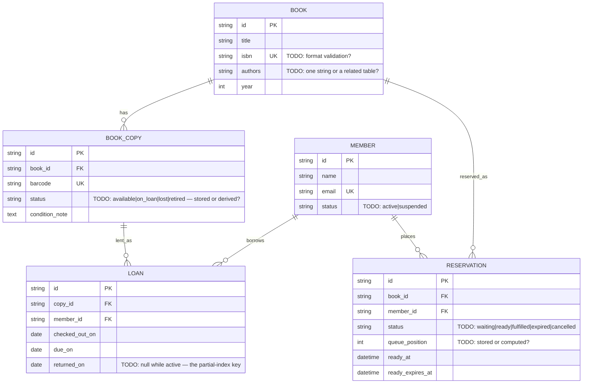

# 05 — Library / Rental System

Difficulty ★★★ · Focus: state machines · title-vs-instance modeling · row-level concurrency · business rules as error codes

Expected effort: two sessions. Builds on [04](04-expense-splitter.md) (derived data discipline).

## The brief

> "A small library. We own *books* — titles like 'The Hobbit' — and each title may have several physical *copies* on the shelf. Members check out a copy for 14 days. A copy on loan obviously can't be loaned again until it's back. When every copy of a title is out, members can reserve the *title*; when a copy is returned, the earliest reservation becomes 'ready for pickup' and waits 3 days, then expires. A member can have at most 5 active loans, and anyone with an overdue loan can't check out anything new. Checkouts and returns happen at the desk — staff call those endpoints, not members. Reservations, members make themselves."

## Requirements (user stories)

1. Catalog: create/edit books (title, authors, ISBN, year).
2. Inventory: register physical copies of a book, each with a barcode (unique) and a condition note. A copy can be marked lost or retired — permanently out of circulation.
3. Members: register, suspend, reinstate.
4. Checkout: staff loans an *available copy* to an eligible member; due date = checkout + 14 days.
5. Return: staff marks a loan returned. If reservations for that title exist, the earliest becomes `ready` with a 3-day pickup deadline.
6. Reserve: a member may reserve a title only when no copy is currently available; queue per title. A member with the title already on loan may not reserve it.
7. A `ready` reservation expires after 3 days — then what: next in queue gets it, or it dissolves? Decide.
8. Overdue = `due_date` passed and not returned. An endpoint reports current overdue loans. (Derived or stored? Decide.)
9. Rules: max 5 active loans per member; no checkout while any loan is overdue; suspended members can't check out. Each rule violated must produce a distinct, machine-readable error.

## Design decisions to resolve

- **Book vs Copy** is *the* modeling lesson: loans reference a copy; reservations reference a title. Why can't one table do both jobs? (Try it: where does "available" live?)
- **Copy status — stored column or derived?** If `copies.status` says `available` but an open loan row exists, which one is lying? Pick a source of truth and design the transaction that keeps them consistent.
- **Overdue: derive or maintain?** `due_date < today AND returned_at IS NULL` needs no cron job and can't drift; a background job writing `status=overdue` is explicit but can lag. Choose, and note what the other choice would have bought.
- **State machines** — draw them before writing DDL:
  - Loan: `active → returned`, and `active → lost` (member never brought it back).
  - Reservation: `waiting → ready → fulfilled | expired | cancelled`.
  For each transition: who triggers it (staff endpoint, member endpoint, background sweep, or lazy check at read time)?
- **Expiry of `ready` reservations**: background job vs lazy check ("if `ready_at < now - 3d` treat as expired")? What does the *list endpoint* show for a reservation that expired 2 minutes ago?
- **Concurrency at the desk**: two staff check out the same copy at the same second. What prevents the double-loan? (Hint: a partial unique index on "one active loan per copy" makes the DB itself the referee.) Same question for two members grabbing the last reservation slot.
- Every business rule needs a machine error code: `member_overdue`, `loan_limit_reached`, `copy_not_available`, `member_suspended`, `title_on_loan_to_you`… Design the set now; the contract references them.
- Reservation fairness: strictly FIFO by `created_at`? Tiebreak when two reservations share a timestamp?

## Starter ERD



## Suggested API surface (react to it, don't obey it)

- `GET /books`, `POST /books`, `GET/PATCH /books/{bookId}`
- `GET /books/{bookId}/copies`, `POST /books/{bookId}/copies`, `PATCH /copies/{copyId}`
- `GET /members`, `POST /members`, `PATCH /members/{memberId}` (suspend/reinstate)
- `POST /loans` — checkout (staff); `POST /loans/{loanId}/return`; `GET /loans?overdue=true`
- `POST /books/{bookId}/reservations` (member); `DELETE /reservations/{id}` = cancel; `GET /members/{id}/reservations`
- `GET /books/{bookId}/availability` — copies in, reservations queued

## OpenAPI skeleton

```yaml
openapi: 3.1.0
info:
  title: Library API
  version: 0.1.0
paths:
  /loans:
    post:
      # TODO: body {copy_id, member_id} (staff checkout)
      # TODO: 201 | 409 copy_not_available | 422 loan_limit_reached
      #       | 422 member_overdue | 422 member_suspended
      #       — each 422 uses the house Error envelope with its code
      responses: {}
  /loans/{loanId}/return:
    post:
      # TODO: 200 with loan + resulting reservation state change?
      #       What does the response look like when a reservation just became ready?
      responses: {}
  /books/{bookId}/reservations:
    post:
      # TODO: 201 | 409 already_reserved_by_you | 422 copies_available_no_reservation
      #       | 422 title_on_loan_to_you
      responses: {}
  /books/{bookId}/availability:
    get:
      # TODO: {copies_available, active_loans, queue_length, next_ready_at?}
      #       — is this derived or read from stored status? your earlier decision shows here
      responses: {}
components:
  schemas:
    Error: {}   # TODO: house envelope + this project's error codes as an enum? or free string?
```

## Gotchas to test

- The double-checkout race: run the checkout twice concurrently for one copy. Exactly one succeeds — *by database constraint*, not by luck.
- Return a copy when the reservation queue is empty, vs. non-empty — both paths.
- `ready` reservation hits its 3-day limit: next-in-queue promoted, or queue dissolved? Whatever you chose, the `queue_position` math must survive it.
- A member at loan limit 5 returns one and immediately checks out two — sequencing through your rules.
- Retiring a copy that is currently on loan — blocked, or allowed with the loan forced to `lost`?

## Self-review checklist

- [ ] Loans reference copies; reservations reference titles. Both relationships are FKs.
- [ ] "Available copy" has exactly one source of truth; a partial unique index (or equivalent) enforces one active loan per copy.
- [ ] Both state machines are drawn, and every arrow maps to an endpoint, a job, or a lazy check — named.
- [ ] Every business rule has a distinct error code in the contract.
- [ ] Overdue and availability are computed the way you decided — consistently in every endpoint that needs them.
