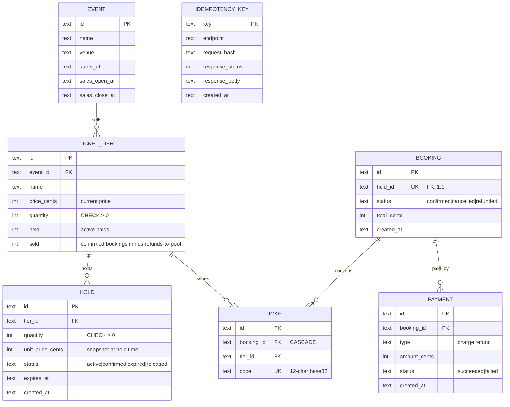

# 06 — Event Ticketing · Solution

> **Spoiler.** Commit first. Oversell prevention, the idempotency replay contract, and hold expiry are the three components interviewers probe here.

## Assumptions

1. Two audiences: **customers** (holds, confirm, bookings) and **admins** (events, tiers). Auth inherited from project 03; scope-based, not path-based.
2. Inventory: **per-tier counters** (`quantity`, `held`, `sold`), not one row per ticket. Individual tickets materialize only inside a confirmed booking (`tickets` rows with codes). "Remaining" is `quantity − sold − held`.
3. Hold TTL: 10 minutes. Expiry is **lazy-validated at every touch** plus a **periodic sweep** that releases expired holds back to `held` — the sweep is hygiene, the *validation at confirm* is the correctness (a stale hold is rejected even if the sweep hasn't run).
4. Payments are a synchronous stub (no PSP integration): a payment row records the outcome. **Refund = a new payment row** (`type=refund`), preserving the attempt history — payments are never mutated.
5. Booking states: `confirmed → cancelled | refunded`. There is **no** `pending_payment` booking: a booking exists only once payment succeeded; a failed payment leaves only the (still valid) hold.
6. Idempotency semantics — the part clients will get wrong, so it's spelled out:
   - Same key + same body → replay the **original** response (including a payment *failure*).
   - Same key + different body → `422 idempotency_conflict`.
   - Deliberate retry after a failed payment → **new key**.
   - Two concurrent requests with the same key → one executes; the other waits and replays.
7. Cancel window: allowed while `now ≤ starts_at − 24h` (inclusive boundary, stated). Refunded tickets **return to the pool** (`sold` decremented) — a product decision, stated in the contract.
8. Price changes mid-hold: the hold stores the **price at hold time** (`unit_price_cents` on the hold) — the confirm honors it; admins changing the tier price affects only future holds. (Snapshot instinct, same as project 07.)

## Data model



## Schema (DDL — Postgres)

```sql
CREATE TABLE events (
  id             UUID PRIMARY KEY DEFAULT gen_random_uuid(),
  name           TEXT NOT NULL,
  venue          TEXT NOT NULL,
  starts_at      TIMESTAMPTZ NOT NULL,
  sales_open_at  TIMESTAMPTZ NOT NULL,
  sales_close_at TIMESTAMPTZ NOT NULL,
  CHECK (sales_open_at < sales_close_at AND sales_close_at <= starts_at)
);

CREATE TABLE ticket_tiers (
  id          UUID PRIMARY KEY DEFAULT gen_random_uuid(),
  event_id    UUID NOT NULL REFERENCES events(id) ON DELETE CASCADE,
  name        TEXT NOT NULL,
  price_cents BIGINT NOT NULL CHECK (price_cents > 0),
  quantity    INT  NOT NULL CHECK (quantity > 0),
  held        INT  NOT NULL DEFAULT 0,
  sold        INT  NOT NULL DEFAULT 0,
  CHECK (held >= 0 AND sold >= 0 AND held + sold <= quantity)
);
```

That final row-level `CHECK (held + sold <= quantity)` is the oversell backstop: even a bug in the application's conditional UPDATE cannot commit counters that oversell the tier.

```sql
CREATE TABLE holds (
  id               UUID PRIMARY KEY DEFAULT gen_random_uuid(),
  tier_id          UUID NOT NULL REFERENCES ticket_tiers(id),
  quantity         INT NOT NULL CHECK (quantity > 0),
  unit_price_cents BIGINT NOT NULL,
  status           TEXT NOT NULL DEFAULT 'active'
                   CHECK (status IN ('active','confirmed','expired','released')),
  expires_at       TIMESTAMPTZ NOT NULL,
  created_at       TIMESTAMPTZ NOT NULL DEFAULT now()
);
CREATE INDEX idx_holds_sweep ON holds(status, expires_at) WHERE status = 'active';

CREATE TABLE bookings (
  id          UUID PRIMARY KEY DEFAULT gen_random_uuid(),
  hold_id     UUID NOT NULL UNIQUE REFERENCES holds(id),
  status      TEXT NOT NULL DEFAULT 'confirmed'
              CHECK (status IN ('confirmed','cancelled','refunded')),
  total_cents BIGINT NOT NULL,
  created_at  TIMESTAMPTZ NOT NULL DEFAULT now()
);

CREATE TABLE tickets (
  id         UUID PRIMARY KEY DEFAULT gen_random_uuid(),
  booking_id UUID NOT NULL REFERENCES bookings(id) ON DELETE CASCADE,
  tier_id    UUID NOT NULL REFERENCES ticket_tiers(id),
  code       TEXT NOT NULL UNIQUE
);

CREATE TABLE payments (
  id           UUID PRIMARY KEY DEFAULT gen_random_uuid(),
  booking_id   UUID NOT NULL REFERENCES bookings(id),
  type         TEXT NOT NULL CHECK (type IN ('charge','refund')),
  amount_cents BIGINT NOT NULL CHECK (amount_cents > 0),
  status       TEXT NOT NULL CHECK (status IN ('succeeded','failed')),
  created_at   TIMESTAMPTZ NOT NULL DEFAULT now()
);

CREATE TABLE idempotency_keys (
  key            TEXT PRIMARY KEY,
  endpoint       TEXT NOT NULL,
  request_hash   TEXT NOT NULL,
  response_status INT,
  response_body  TEXT,
  created_at     TIMESTAMPTZ NOT NULL DEFAULT now()
);
```

## API contract

### Endpoint map

| Method | Path | Success | Errors |
|---|---|---|---|
| GET / POST / PATCH | `/events…` (admin) | `200/201/200` | `403`, `422` |
| GET | `/events/{eventId}/availability` | `200` per-tier remaining | `404` |
| POST | `/holds` | `201` `{hold_id, expires_at, unit_price_cents}` | `409 insufficient_remaining`, `422 sales_not_open`, `422 event_closed`, `422 validation_failed` |
| POST | `/holds/{holdId}/confirm` — **`Idempotency-Key` required** | `201` Booking (+ `200` replay) | `409 hold_expired`, `409 hold_already_used`, `422 idempotency_conflict`, `422 payment_failed`, `422 validation_failed` |
| GET | `/bookings/{bookingId}` | `200` Booking + tickets | `404` |
| POST | `/bookings/{bookingId}/cancel` | `200` Booking (refunded) | `409 already_cancelled`, `422 cancel_window_closed` |

### The three load-bearing transactions

**Create hold** — one statement decides:

```sql
UPDATE ticket_tiers
   SET held = held + :qty
 WHERE id = :tier
   AND quantity - sold - held >= :qty;      -- rowcount 0 → 409 insufficient_remaining
INSERT INTO holds (...);                     -- then, in the same tx
```

**Confirm** — validate → charge → convert, all one transaction:

```sql
BEGIN;
  SELECT * FROM holds WHERE id = :hold FOR UPDATE;
  -- status <> 'active' OR expires_at <= now()  → ROLLBACK 409 hold_expired
  -- (the expired hold's 'held' count is released by the sweep or here)
  UPDATE ticket_tiers
     SET held = held - :qty, sold = sold + :qty
   WHERE id = :tier AND held >= :qty;       -- rowcount 0 → ROLLBACK 409 hold_expired
  INSERT INTO bookings ...;  INSERT INTO tickets ... (one per seat);
  INSERT INTO payments (type='charge', status=:result);
  -- :result = 'succeeded' → COMMIT (booking confirmed)
  -- :result = 'failed'   → ROLLBACK booking/tickets, keep hold; RETURN 422 payment_failed
```

**Idempotent wrapper** around confirm:

```sql
INSERT INTO idempotency_keys (key, endpoint, request_hash)
VALUES (:key, 'confirm', :hash)
ON CONFLICT (key) DO NOTHING;               -- rowcount 0 → someone got here first
-- first:   run the flow, then UPDATE idempotency_keys SET response_status/body
-- racer:   poll the row (≤ 2 s); replay its stored response, or 422 on hash mismatch
```

### OpenAPI (the load-bearing parts)

```yaml
openapi: 3.1.0
info:
  title: Ticketing API
  version: 1.0.0
  description: |
    Idempotency: mutating endpoints require an Idempotency-Key header. Replays return
    the ORIGINAL response — including a payment failure. Use a fresh key for a
    deliberate retry. Availability is accurate at read time (live counter arithmetic);
    expired holds disappear from it the moment they are validated or swept.
paths:
  /events/{eventId}/availability:
    get:
      responses:
        "200":
          content:
            application/json:
              schema:
                type: object
                properties:
                  data:
                    type: array
                    items:
                      type: object
                      required: [tier_id, remaining]
                      properties:
                        tier_id: { type: string, format: uuid }
                        remaining: { type: integer, minimum: 0 }
  /holds:
    post:
      requestBody:
        required: true
        content:
          application/json:
            schema:
              type: object
              required: [tier_id, quantity]
              properties:
                tier_id: { type: string, format: uuid }
                quantity: { type: integer, minimum: 1, maximum: 10 }
      responses:
        "201":
          description: Hold placed; buy before expires_at
          content:
            application/json:
              schema:
                type: object
                required: [hold_id, expires_at, unit_price_cents]
                properties:
                  hold_id: { type: string, format: uuid }
                  expires_at: { type: string, format: date-time }
                  unit_price_cents: { type: integer }
        "409":
          description: insufficient_remaining
          content: { application/json: { schema: { $ref: "#/components/schemas/Error" } } }
  /holds/{holdId}/confirm:
    post:
      parameters:
        - name: Idempotency-Key
          in: header
          required: true
          schema: { type: string, format: uuid }
      responses:
        "201": { description: Booking confirmed with ticket codes }
        "200": { description: Idempotent replay of the original response }
        "409":
          description: hold_expired | hold_already_used
        "422":
          description: payment_failed | idempotency_conflict
```

## Design decisions, answered

| Decision | Choice | Why |
|---|---|---|
| Inventory model | Per-tier counters, tickets materialize at confirm | "Remaining" is one row's arithmetic; oversell has both a conditional UPDATE and a row `CHECK` guarding it. One-row-per-ticket would need aggregate locks to answer "remaining" and makes hot-path writes worse. |
| Oversell prevention | Atomic conditional `UPDATE ... WHERE remaining >= qty` + row `CHECK` | The UPDATE's rowcount is the verdict — no read-then-write gap. `FOR UPDATE` costs the same here but invites forgotten locks; optimistic retries would starve during on-sale bursts. |
| Hold expiry | Lazy validation at every touch + periodic sweep as hygiene | Correctness must not depend on a scheduler's punctuality: an expired hold *always* fails confirm, even mid-sweep. The sweep just returns counters to truth between touches. |
| Availability staleness | Exact at read time (live arithmetic) | Counters are the source; there's nothing to be stale about. The contract says so, and the sweep never changes what the endpoint returns. |
| Payment failure handling | No booking row; hold stays valid; `422 payment_failed` | A booking that "exists but failed" forces every reader to handle a meaningless state. Only success creates bookings; attempts live in `payments`. |
| Refund | New `type=refund` payment row; booking → `refunded`; tickets to the pool | Payments are append-only (an audit trail, like project 10); mutating a charge row to "refunded" destroys the history. |
| Idempotency storage | Shared `idempotency_keys` table, `(key, endpoint, hash, stored response)` | One mechanism reused by 07 and 10; the request hash is what separates "replay" from "conflict". |
| Price mid-hold | Snapshot on the hold | The customer saw a price and started checkout; repricing under them mid-flow is a contract breach. Same principle as order snapshots. |

## Back-of-the-envelope

- On-sale burst for a 10k-ticket event: **5 000 reads/s** (availability page), **~300 holds/s**, **~100 confirms/s** at peak.
- Every hold/confirm serializes on the tier's single row: a row UPDATE takes ~1 ms → ceiling ≈ **700–1 000 ops/s per tier**. One hot tier at 300 holds/s is fine; a stadium where one tier takes the entire burst is the case to watch. Scale-out path: shard a tier's inventory into N counter rows (e.g. 10 × 1000), route holds by hash, reconcile on confirm — noted as the next step, not built.
- Storage: 100 events/year × 10k tickets ≈ 1M bookings/yr ≈ 5M ticket rows ≈ 1 GB/yr. Idempotency rows purged after 24 h (their only job is retry-window replay).
- Ticket codes: 12 chars base32 ≈ 60 bits random — collision odds negligible, uniqueness enforced anyway.

## Gotchas, resolved

- **Oversell race**: 10 concurrent confirms for 2 remaining → exactly 2 `201`, 8 × `409 insufficient_remaining` — proven by the conditional UPDATE rowcount, exercised with `xargs -P`.
- **Same-key retry**: sequential duplicate → `200` replay of the original `201`; concurrent duplicates → one executes, one replays; same key different body → `422 idempotency_conflict`.
- **Hold expiring between availability and confirm** → `409 hold_expired`, and its tickets are already back in the pool (sweep or on-touch release).
- **Cancel at exactly T−24h** → allowed; the comparison is `now <= starts_at - interval '24 hours'`, inclusive, stated on the endpoint.
- **Refund of refunded** → `409 already_cancelled` (cancelled and refunded are the same terminal family for this check).
- **Two bookings from one hold** → `holds.hold_id` is `UNIQUE` on bookings; the confirm's `FOR UPDATE` + status check makes the second attempt `409 hold_already_used`.

## Self-review bar

The oversell proof is a test you ran, not an argument; the idempotency contract covers replay, conflict, concurrency, and deliberate-retry semantics; every state (hold, booking, payment) has a drawn machine with named triggers; the availability endpoint's honesty is written down; money is integers end to end.
