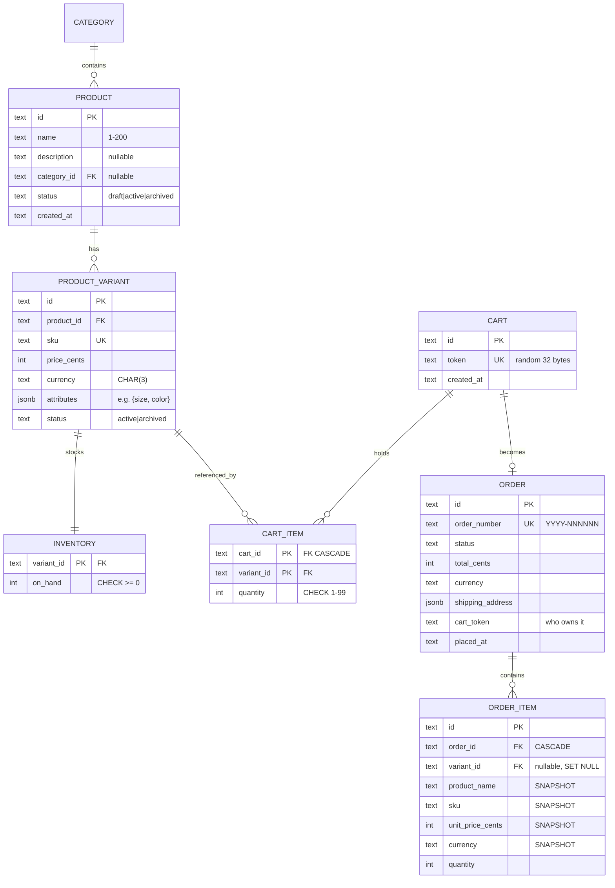

# 07 — E-commerce Catalog & Orders · Solution

> **Spoiler.** Commit first. The price snapshot and the checkout transaction are the two correctness pillars; the filter contract is the API-design pillar.

## Assumptions

1. Auth inherited from project 03. Two audiences: **shoppers** (guest carts via `X-Cart-Token` header; orders visible with the same token that checked out) and **admins** (catalog and order management) — separated by **path** (`/admin/...`), because "what a shopper can never do" should be visible in the URL space, not just in auth middleware.
2. `order_items` **snapshot** `product_name`, `sku`, `unit_price_cents`, and `currency` at checkout. `variant_id` is kept for analytics but is nullable and never joined for rendering — history must render even if the variant is later deleted.
3. Stock lives on an `inventory` table keyed by variant (`on_hand`), mutated only inside checkout/restock transactions. **Add-to-cart checks nothing** — carts are wishes; checkout is the contract. (Stock-reserving at cart time punishes the 98% of carts that never convert.)
4. Checkout is **idempotent** (`Idempotency-Key`, same mechanism as project 06).
5. Order state machine (single transitions endpoint; see decisions):

   | From | Allowed actions |
   |---|---|
   | `pending` | `mark_paid`, `cancel` |
   | `paid` | `ship` (tracking number required), `cancel` |
   | `shipped` | `deliver` |
   | `delivered` | `refund` |
   | `cancelled`, `refunded` | terminal |

6. Money: integers + currency on every price field; totals computed **server-side only** at checkout (`total = Σ unit_price × qty`); shipping is free/out of scope (stated).
7. Catalog filter contract: all params AND-composed; unknown params → `400 unknown_filter` (never silently ignored — a typo'd `catergory` returning unfiltered results is a data-loss-grade bug); empty `q` → ignored; empty result → `200 []`.
8. Guest carts don't merge with user accounts (no user carts in this project) — stated, not forgotten.

## Data model



## Schema (DDL — Postgres)

```sql
CREATE TABLE categories (
  id    UUID PRIMARY KEY DEFAULT gen_random_uuid(),
  name  TEXT NOT NULL,
  slug  TEXT NOT NULL UNIQUE
);

CREATE TABLE products (
  id          UUID PRIMARY KEY DEFAULT gen_random_uuid(),
  name        TEXT NOT NULL CHECK (length(name) BETWEEN 1 AND 200),
  description TEXT,
  category_id UUID REFERENCES categories(id),
  status      TEXT NOT NULL DEFAULT 'draft' CHECK (status IN ('draft','active','archived')),
  created_at  TIMESTAMPTZ NOT NULL DEFAULT now()
);
CREATE INDEX idx_products_catalog ON products(status, category_id, created_at DESC, id DESC);

CREATE TABLE product_variants (
  id          UUID PRIMARY KEY DEFAULT gen_random_uuid(),
  product_id  UUID NOT NULL REFERENCES products(id) ON DELETE CASCADE,
  sku         TEXT NOT NULL UNIQUE,
  price_cents BIGINT NOT NULL CHECK (price_cents > 0),
  currency    CHAR(3) NOT NULL,
  attributes  JSONB NOT NULL DEFAULT '{}',
  status      TEXT NOT NULL DEFAULT 'active' CHECK (status IN ('active','archived'))
);
CREATE INDEX idx_variants_product ON product_variants(product_id);

CREATE TABLE inventory (
  variant_id UUID PRIMARY KEY REFERENCES product_variants(id) ON DELETE CASCADE,
  on_hand    INT NOT NULL DEFAULT 0 CHECK (on_hand >= 0)
);

CREATE TABLE carts (
  id         UUID PRIMARY KEY DEFAULT gen_random_uuid(),
  token      TEXT NOT NULL UNIQUE,
  created_at TIMESTAMPTZ NOT NULL DEFAULT now()
);

CREATE TABLE cart_items (
  cart_id    UUID NOT NULL REFERENCES carts(id) ON DELETE CASCADE,
  variant_id UUID NOT NULL REFERENCES product_variants(id),
  quantity   INT NOT NULL CHECK (quantity BETWEEN 1 AND 99),
  PRIMARY KEY (cart_id, variant_id)
);

CREATE TABLE orders (
  id               UUID PRIMARY KEY DEFAULT gen_random_uuid(),
  order_number     TEXT NOT NULL UNIQUE,        -- '2026-000123', human-facing
  status           TEXT NOT NULL DEFAULT 'pending'
                   CHECK (status IN ('pending','paid','shipped','delivered','cancelled','refunded')),
  total_cents      BIGINT NOT NULL,
  currency         CHAR(3) NOT NULL,
  shipping_address JSONB NOT NULL,
  cart_token       TEXT NOT NULL,
  placed_at        TIMESTAMPTZ NOT NULL DEFAULT now()
);
CREATE INDEX idx_orders_token ON orders(cart_token, placed_at DESC);

CREATE TABLE order_items (
  id               UUID PRIMARY KEY DEFAULT gen_random_uuid(),
  order_id         UUID NOT NULL REFERENCES orders(id) ON DELETE CASCADE,
  variant_id       UUID REFERENCES product_variants(id) ON DELETE SET NULL,
  product_name     TEXT NOT NULL,               -- snapshot
  sku              TEXT NOT NULL,               -- snapshot
  unit_price_cents BIGINT NOT NULL,             -- snapshot
  currency         CHAR(3) NOT NULL,            -- snapshot
  quantity         INT NOT NULL CHECK (quantity > 0)
);
```

## API contract

### Endpoint map

| Method | Path | Success | Errors |
|---|---|---|---|
| GET | `/products?category=&price_min=&price_max=&in_stock=&q=&sort=&limit=&cursor=` | `200` (published/active only) | `400 unknown_filter`, `400 invalid_cursor` |
| GET | `/products/{productId}` | `200` with variants + availability | `404` (drafts invisible to shoppers) |
| POST / PATCH | `/admin/products…`, `/admin/variants…`, `/admin/inventory/restock` | `201`/`200` | `403`, `422` |
| POST | `/carts` | `201` `{cart_id, token}` | — |
| GET | `/carts/{cartId}` (header `X-Cart-Token`) | `200` with line totals | `404`, `403 token_mismatch` |
| POST / PATCH / DELETE | `/carts/{cartId}/items…` | `200/200/204` | `404`, `422` |
| POST | `/carts/{cartId}/checkout` — `Idempotency-Key` | `201` Order (+`200` replay) | `409 out_of_stock` (lists SKUs), `409 cart_empty`, `422 invalid_address`, `422 idempotency_conflict` |
| GET | `/orders/{orderNumber}` (token-scoped) | `200` Order | `404` |
| POST | `/admin/orders/{orderNumber}/transitions` | `200` Order | `403`, `404`, `422 invalid_transition`, `422 missing_field` |

**`409 out_of_stock` body** — the client must be able to render exactly what's wrong:

```json
{ "error": { "code": "out_of_stock", "message": "Some items are no longer available",
  "details": { "skus": [ { "sku": "TS-SHIRT-M-BLK", "requested": 2, "available": 0 } ] } } }
```

### Checkout transaction

```sql
BEGIN;
  -- lock inventory rows in a deterministic order to avoid deadlocks
  SELECT variant_id FROM cart_items WHERE cart_id = :cart
  -- (sort the resulting SKUs app-side, then:)
  UPDATE inventory SET on_hand = on_hand - :qty
   WHERE variant_id = :v AND on_hand >= :qty;   -- rowcount 0 → abort, collect SKU
  -- all lines ok →
  INSERT INTO orders (...);
  INSERT INTO order_items (... snapshot columns populated by a JOIN at insert time ...);
  DELETE FROM cart_items WHERE cart_id = :cart;
  -- idempotency row written (same mechanism as project 06)
COMMIT;
```

### OpenAPI (the load-bearing parts)

```yaml
openapi: 3.1.0
info:
  title: Shop API
  version: 1.0.0
paths:
  /products:
    get:
      description: |
        Filters AND together. Unknown filter names are 400 unknown_filter.
        price_min/price_max are integer cents, inclusive. in_stock=true means
        every listed variant has on_hand > 0. sort: newest (default) | price.
      parameters:
        - { name: category,  in: query, schema: { type: string } }
        - { name: price_min, in: query, schema: { type: integer, minimum: 0 } }
        - { name: price_max, in: query, schema: { type: integer, minimum: 0 } }
        - { name: in_stock,  in: query, schema: { type: boolean } }
        - { name: q,         in: query, schema: { type: string, maxLength: 100 } }
        - { name: sort,      in: query, schema: { type: string, enum: [newest, price] } }
      responses:
        "200": { description: Page of active products with variant summaries }
        "400": { description: unknown_filter | invalid_cursor }
  /carts/{cartId}/checkout:
    post:
      parameters:
        - { name: Idempotency-Key, in: header, required: true, schema: { type: string, format: uuid } }
        - { name: X-Cart-Token, in: header, required: true, schema: { type: string } }
      requestBody:
        required: true
        content:
          application/json:
            schema:
              type: object
              required: [shipping_address]
              properties:
                shipping_address: { type: object }
      responses:
        "201": { description: Order placed; totals frozen; stock deducted }
        "200": { description: Idempotent replay }
        "409": { description: out_of_stock (details.skus) | cart_empty }
  /admin/orders/{orderNumber}/transitions:
    post:
      description: |
        One endpoint, one place for transition rules. Actions: mark_paid, cancel,
        ship (requires tracking_number), deliver, refund. Anything else per the
        state machine is 422 invalid_transition.
      requestBody:
        content:
          application/json:
            schema:
              type: object
              required: [action]
              properties:
                action: { type: string, enum: [mark_paid, cancel, ship, deliver, refund] }
                tracking_number: { type: string }
      responses:
        "200": { description: Updated order }
        "422": { description: invalid_transition | missing_field }
```

## Design decisions, answered

| Decision | Choice | Why |
|---|---|---|
| Price snapshot | Copied into `order_items` at checkout | Orders are financial history. Joining live prices means an admin's Tuesday price change rewrites every historical invoice — the denormalization is a *correctness requirement*, not a performance trick. Same instinct as the hold price in project 06. |
| Stock: deduct when | Checkout transaction only, conditional `UPDATE ... WHERE on_hand >= qty` | Cart-time reservation punishes non-converting carts (the majority) and builds a whole hold-expiry subsystem for nothing (you built that once — project 06 — and know its price). |
| Cart ↔ order | Cart consumed at checkout (`cart_items` deleted), order created | A cart that converts shouldn't linger half-empty; `GET /carts/{id}` after checkout → `404`, which is honest. |
| Admin surface | Path-based (`/admin/...`) | The shopper-visible contract shrinks to exactly what exists; auth scope *and* path both say "admin". |
| Transitions | Single `POST /transitions` with `action` enum | Five endpoints would each carry a copy of "from which states is this legal"; one endpoint means one transition table, one `422 invalid_transition` behavior. |
| Order numbers | Both: opaque `id` (FKs) + human `order_number` (`YYYY-NNNNNN`) | Customers read order numbers aloud to support; databases join on the opaque id. Support emails containing `0f7c…e2b1` are a support-team mutiny event. |
| Search | `ILIKE '%q%'` on name | Honest at this scale; pg_trgm GIN index is the noted upgrade at ~10⁵ products. |
| `variant_id` on order_items | Nullable FK, `ON DELETE SET NULL` | Deleting a product must not delete financial history; the snapshot columns make the row self-sufficient regardless. |

## Back-of-the-envelope

- Catalog: 10k products × 4 variants = 40k SKUs. Catalog list = index scan on `(status, category_id, created_at DESC, id DESC)` → cursor page of 24, microseconds. `ILIKE` scans 10k names ≈ single-digit ms — fine; pg_trgm at 10⁵+.
- Orders: 500/day × ~1 KB (order + 3 items) ≈ **180 MB/year** — snapshots are cheap because they're small.
- Checkout burst: flash-sale 200 checkouts/s on one variant → serialized single-row UPDATEs at ~1 ms → ceiling ~1 000/s per SKU; the queue-based answer (project 06's tier bucketing) is the noted scale-out.
- Restock events are rare writes; `inventory` is the hottest little table in the system and the one the transaction discipline exists for.

## Gotchas, resolved

- **Price change after order** → order fetch returns the snapshot price; verified by changing a price then re-reading the order.
- **Two concurrent checkouts, last unit** → one `201`, one `409 out_of_stock` naming the SKU — the conditional UPDATE's rowcount decides.
- **Same idempotency key twice** → identical order, stock deducted once (replay path).
- **Variant archived while in a cart** → checkout rejects that line: add `422 variant_unavailable` (or treat as `out_of_stock` with the SKU listed — pick one; the solution picks `out_of_stock`, since to a shopper "can't buy it" is one condition).
- **`price_min=abc`** → `400 invalid_param` (typed schema validation), while `?catergory=shoes` → `400 unknown_filter`. Typos are caught, not absorbed.

## Self-review bar

`order_items` renders history with zero joins to catalog tables — and you can say why that matters in money terms; stock deduction is one conditional statement inside the transaction with deterministic lock ordering; the filter contract specifies AND semantics, unknown-param behavior, and sort; every transition violation is `422 invalid_transition` from one table.
