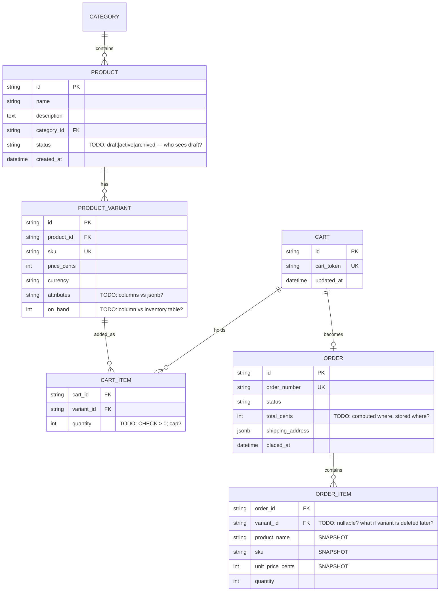

# 07 — E-commerce Catalog & Orders

Difficulty ★★★★ · Focus: price snapshots (denormalization as necessity) · catalog filter contracts · checkout transactions · order lifecycle

Expected effort: two to three sessions. Builds on [06](06-event-ticketing.md) (idempotency, transactions).

## The brief

> "An online store. Products have a name, description, and category, and come in one or more variants — size, color — each with its own SKU, its own price, and its own stock. Shoppers browse and filter: by category, price range, only-in-stock, and free-text search on the name. They add variants to a cart, then check out. At checkout the cart becomes an order — and here's the rule: the order keeps the prices as they were *at purchase time*, forever, even if we change prices tomorrow. Checkout deducts stock. Orders go pending → paid → shipped → delivered; an order can be cancelled before it ships; a refund happens only after delivery. Prices and stock change all the time. Order history must never change."

## Requirements (user stories)

1. Admin: create/edit products, assign a category, add variants (attributes, SKU, `price_cents`), restock.
2. Catalog: list products with filters — category, price range, in-stock only — plus free-text search on name, sortable by price or newest, paginated.
3. Product detail: the product with all variants, each showing SKU, price, availability.
4. Cart: identified by a cart token (guests shop too); add line items, change quantities, remove.
5. Add-to-cart checks nothing — the truth is checked at checkout. (A deliberate decision — know why stores do it this way.)
6. Checkout: cart + shipping address → order. **Idempotent.** Atomically deducts stock. If any SKU went out of stock since the cart was built, the whole checkout fails with a `409` listing exactly which SKUs.
7. Order: line items snapshot `product_name`, `sku`, `unit_price_cents` *at purchase time*; totals computed server-side only.
8. Order transitions: `pending → paid → shipped (tracking number attached) → delivered`; `pending|paid → cancelled`; `delivered → refunded`. Anything else is a `422 invalid_transition`.
9. Money: integer cents + currency on every price field.

## Design decisions to resolve

- **The snapshot** is *the* lesson: `order_items` copies `product_name`, `sku`, `unit_price_cents` at checkout instead of joining to the live tables. Why is the join wrong — what does an admin renaming a product or changing a price do to historical orders? (This is denormalization not as an optimization but as a *correctness requirement*. Say it in your assumptions.)
- **Stock deduction**: atomic conditional update per variant inside the checkout transaction. Two checkouts of the last unit race — one wins. Where does `on_hand` live (variant column vs inventory table)? What does "in stock" mean for the filter when 1 unit is left and a cart already wants 2?
- **Cart lifetime**: token-based guest carts. Anonymous cart → logged-in user later: merge? Discard? Out of scope if you say so — in writing.
- **The filter contract** — design it once, precisely: `?category=shoes&price_min=2000&price_max=10000&in_stock=true&q=trail` or a richer syntax (`?price=gte:2000`)? Whichever you pick, write down: multi-value filters (AND or OR?), unknown filter names (`400` or ignored?), empty results (`200 []`).
- **Search**: `ILIKE` is fine at this scale; say so. What if the client sends an empty `q` — everything or nothing?
- **Admin vs shopper surface**: same resources, two audiences. Path-based (`/admin/products`) vs scope-based auth on shared paths. Pick one; the contract must make "what a shopper can never do" visible.
- SKU uniqueness: globally unique? Per brand? What constraint says so?
- Order numbers: the opaque internal id vs a human-friendly `order_number` (`2026-000123`) — both? Which one appears in URLs?

## Starter ERD



## Suggested API surface (react to it, don't obey it)

- `GET /products` (catalog filters), `GET /products/{productId}`
- Admin: `POST /products`, `PATCH /products/{id}`, `POST /products/{id}/variants`, `POST /variants/{id}/restock`
- `POST /carts`, `GET /carts/{cartId}` (by token), `POST /carts/{cartId}/items`, `PATCH/DELETE /carts/{cartId}/items/{itemId}`
- `POST /carts/{cartId}/checkout` — idempotent
- `GET /orders/{orderId}`, `GET /orders` (mine)
- Admin transitions: `POST /orders/{id}/mark-paid`, `/ship`, `/deliver`, `/cancel`, `/refund` — or one `POST /orders/{id}/transitions`? Decide.

## OpenAPI skeleton

```yaml
openapi: 3.1.0
info:
  title: Shop API
  version: 0.1.0
paths:
  /products:
    get:
      # TODO: parameters — category, price_min, price_max, in_stock, q, sort, limit/cursor
      #       description documents: AND semantics, unknown filter = 400, empty q = ignored
      responses: {}
  /carts/{cartId}/checkout:
    post:
      parameters:
        - name: Idempotency-Key
          in: header
          required: true
          schema: { type: string, format: uuid }
      # TODO: 201 order | 409 out_of_stock {details: {skus: [...]}} | 422 empty_cart
      #       | 200 replayed
      responses: {}
  /orders/{orderId}:
    get:
      # TODO: order + items with snapshot fields; 404 (or is-order-yours? you have no auth
      #       unless you carried it over from 03 — decide: guest orders vs user orders)
      responses: {}
components:
  schemas:
    Error: {}   # TODO: house envelope; out_of_stock carries a details payload — model it
```

## Gotchas to test

- Change a product's price *after* an order exists; fetch the order. The old price must still be there — from the snapshot, not luck.
- Two concurrent checkouts, last unit: one `201`, one `409 out_of_stock` naming the SKU.
- Checkout the same cart twice with the same idempotency key → same order, stock deducted once.
- A variant archived after it sits in a cart: checkout of that cart → which error?
- Filter `price_min=abc` → `400 invalid_filter`, not `200` silently ignoring it. Verify your decision is implemented.

## Self-review checklist

- [ ] `order_items` is self-sufficient: no join to products/variants needed to render history — and you can say why that matters.
- [ ] Stock deduction is one conditional statement inside the checkout transaction; you've raced it and it held.
- [ ] The filter contract is written down: AND/OR, unknown-param behavior, sort stability, pagination style.
- [ ] Every order transition is listed with its precondition; violations are `422 invalid_transition`.
- [ ] Totals computed server-side; the client never sends a price.
