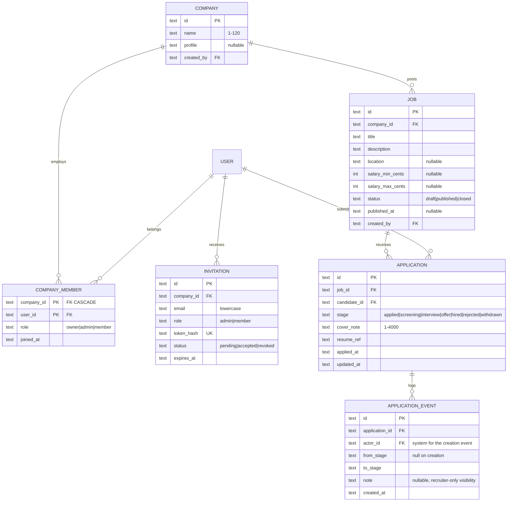

# 08 — Job Board with Roles · Solution

> **Spoiler.** Commit first. The capability matrix, the 404 discipline, and the append-only event log are the three things this project is really testing.

## Assumptions

1. **One `users` table**; a person may be both a candidate and a recruiter — company affiliation is a *membership* (`company_members`), not an identity. Candidates are just users without a membership (or with one — nothing stops a recruiter from applying elsewhere).
2. Roles inside a company: `owner | admin | member`. Capability matrix, written before any endpoint:

   | Capability | owner | admin | member | candidate (other) |
   |---|---|---|---|---|
   | Create company | — (creator becomes owner) | | | |
   | Edit company profile | ✓ | ✓ | ✗ | |
   | Invite members | ✓ | ✓ | ✗ | |
   | Create/edit own company's jobs (drafts) | ✓ | ✓ | ✓ | |
   | Publish/close jobs | ✓ | ✓ | ✗ | |
   | View applicants | ✓ | ✓ | ✓ | |
   | Move application stages | ✓ | ✓ | ✓ | |
   | Manage webhooks (project 09 preview) | ✓ | ✓ | ✗ | |
   | View foreign company's jobs (drafts) | | | | `404` |
   | Move any application | | | | `404` |

3. **The isolation rule, applied twice**: out-of-scope resources (foreign company's drafts/applications, another candidate's application) → `404`, byte-identical to nonexistent. In-scope but insufficient role (a `member` trying to publish) → `403 insufficient_role`. `403` exists *only* here — where existence is already known to the caller.
4. Pipeline state machine (encoded in one transition table):

   ```
   applied   → screening | rejected
   screening → interview | rejected
   interview → offer     | rejected
   offer     → hired     | rejected
   hired, rejected, withdrawn → terminal
   ```

   Rejection is legal from any live stage and **requires a note** (`422 rejection_note_required`). No stage-skipping (`applied → hired` is `422 invalid_transition`).
5. **Duplicate applications**: `UNIQUE(job_id, candidate_id) WHERE stage <> 'withdrawn'`. Withdrawal frees the candidate to reapply (new row); a rejection is forever for that job — reapplying after rejection is not possible (both decisions stated in the contract).
6. **The event log is append-only** — `application_events` gets `REVOKE UPDATE, DELETE`. The candidate timeline and the recruiter audit view read the same rows, differing only in a visibility rule: **notes are recruiter-only**; the candidate sees stage changes and dates, never the note text.
7. Draft visibility is enforced in the *query* (candidate-facing reads filter `status='published'`), so a direct id hit returns `404` — response-level filtering would leak draft existence to anyone who guesses an id.
8. Resume: an opaque reference string matching `^resume:[A-Za-z0-9]{22}$`; upload/download out of scope, format validated, value stored as-is.

## Data model



## Schema (DDL — Postgres)

```sql
CREATE TABLE companies (
  id         UUID PRIMARY KEY DEFAULT gen_random_uuid(),
  name       TEXT NOT NULL CHECK (length(name) BETWEEN 1 AND 120),
  profile    TEXT,
  created_by UUID NOT NULL REFERENCES users(id),
  created_at TIMESTAMPTZ NOT NULL DEFAULT now()
);

CREATE TABLE company_members (
  company_id UUID NOT NULL REFERENCES companies(id) ON DELETE CASCADE,
  user_id    UUID NOT NULL REFERENCES users(id) ON DELETE CASCADE,
  role       TEXT NOT NULL CHECK (role IN ('owner','admin','member')),
  joined_at  TIMESTAMPTZ NOT NULL DEFAULT now(),
  PRIMARY KEY (company_id, user_id)
);

CREATE TABLE invitations (
  id         UUID PRIMARY KEY DEFAULT gen_random_uuid(),
  company_id UUID NOT NULL REFERENCES companies(id) ON DELETE CASCADE,
  email      TEXT NOT NULL,
  role       TEXT NOT NULL CHECK (role IN ('admin','member')),
  token_hash TEXT NOT NULL UNIQUE,
  status     TEXT NOT NULL DEFAULT 'pending' CHECK (status IN ('pending','accepted','revoked')),
  expires_at TIMESTAMPTZ NOT NULL,
  created_at TIMESTAMPTZ NOT NULL DEFAULT now()
);

CREATE TABLE jobs (
  id              UUID PRIMARY KEY DEFAULT gen_random_uuid(),
  company_id      UUID NOT NULL REFERENCES companies(id) ON DELETE CASCADE,
  title           TEXT NOT NULL CHECK (length(title) BETWEEN 1 AND 150),
  description     TEXT NOT NULL,
  location        TEXT,
  salary_min_cents BIGINT,
  salary_max_cents BIGINT,
  status          TEXT NOT NULL DEFAULT 'draft' CHECK (status IN ('draft','published','closed')),
  published_at    TIMESTAMPTZ,
  created_by      UUID NOT NULL REFERENCES users(id),
  created_at      TIMESTAMPTZ NOT NULL DEFAULT now(),
  CHECK (salary_min_cents IS NULL OR salary_max_cents IS NULL OR salary_max_cents >= salary_min_cents)
);
CREATE INDEX idx_jobs_public ON jobs(status, created_at DESC) WHERE status = 'published';
CREATE INDEX idx_jobs_company ON jobs(company_id, status, created_at DESC);

CREATE TABLE applications (
  id           UUID PRIMARY KEY DEFAULT gen_random_uuid(),
  job_id       UUID NOT NULL REFERENCES jobs(id) ON DELETE CASCADE,
  candidate_id UUID NOT NULL REFERENCES users(id),
  stage        TEXT NOT NULL DEFAULT 'applied'
               CHECK (stage IN ('applied','screening','interview','offer','hired','rejected','withdrawn')),
  cover_note   TEXT NOT NULL CHECK (length(cover_note) BETWEEN 1 AND 4000),
  resume_ref   TEXT NOT NULL CHECK (resume_ref ~ '^resume:[A-Za-z0-9]{22}$'),
  applied_at   TIMESTAMPTZ NOT NULL DEFAULT now(),
  updated_at   TIMESTAMPTZ NOT NULL DEFAULT now()
);
-- one live (or ever-rejected) application per candidate per job; withdrawn may reapply
CREATE UNIQUE INDEX one_application_per_job
  ON applications(job_id, candidate_id) WHERE stage <> 'withdrawn';
CREATE INDEX idx_applications_job ON applications(job_id, stage, applied_at DESC);

CREATE TABLE application_events (
  id             UUID PRIMARY KEY DEFAULT gen_random_uuid(),
  application_id UUID NOT NULL REFERENCES applications(id) ON DELETE CASCADE,
  actor_id       UUID REFERENCES users(id),      -- NULL = system (creation event)
  from_stage     TEXT,
  to_stage       TEXT NOT NULL,
  note           TEXT,
  created_at     TIMESTAMPTZ NOT NULL DEFAULT now()
);
CREATE INDEX idx_events_application ON application_events(application_id, created_at);

-- Immutability, mechanically:
REVOKE UPDATE, DELETE ON application_events FROM app_role;
```

## API contract

### Endpoint map

| Method | Path | Success | Errors |
|---|---|---|---|
| POST | `/companies` | `201` (creator = owner) | `422` |
| POST | `/companies/{id}/invitations` | `201` (admin+, invite token in response, shown once) | `403 insufficient_role`, `409 already_member` |
| POST | `/invitations/accept` | `200` membership | `410 invitation_expired`, `422` |
| POST / GET | `/companies/{id}/jobs` (drafts included — members only) | `201`/`200` | `404` (non-member), `403 insufficient_role` (publish) |
| POST | `/companies/{id}/jobs/{jobId}/publish` · `/close` | `200` | `403 insufficient_role`, `409 already_published` |
| GET | `/jobs?location=&salary_min=&q=&limit=&cursor=` | `200` **published only** | `400` |
| GET | `/jobs/{jobId}` | `200` (published; drafts `404` for outsiders) | `404` |
| POST | `/jobs/{jobId}/applications` | `201` Application | `409 already_applied`, `422 job_closed`, `404` (draft/unpublished → invisible) |
| GET | `/my/applications`, `/my/applications/{id}` | `200` with timeline (no notes) | `404` |
| POST | `/my/applications/{id}/withdraw` | `200` (terminal) | `404`, `409 already_terminal` |
| GET | `/companies/{id}/jobs/{jobId}/applications?stage=&limit=&cursor=` | `200` | `404` (non-member), `403` |
| POST | `/applications/{id}/advance` `{to_stage}` | `200` Application + event | `404`, `403`, `422 invalid_transition` |
| POST | `/applications/{id}/reject` `{note}` | `200` | `404`, `403`, `422 rejection_note_required`, `422 invalid_transition` |
| GET | `/applications/{id}/events` | `200` full audit (recruiter) | `404`, `403` |

### OpenAPI (the load-bearing parts)

```yaml
openapi: 3.1.0
info:
  title: Job Board API
  version: 1.0.0
  description: |
    Isolation policy: any resource outside the caller's scope returns 404,
    byte-identical to a nonexistent resource. 403 is reserved for in-scope,
    insufficient-role cases. The candidate timeline and the recruiter audit
    log read the same event rows; note text is recruiter-only.
paths:
  /jobs/{jobId}/applications:
    post:
      description: |
        Draft or closed job → 404 (indistinguishable from unknown — drafts do
        not exist for candidates). Published & closed status → 422 job_closed.
      requestBody:
        required: true
        content:
          application/json:
            schema:
              type: object
              required: [cover_note, resume_ref]
              properties:
                cover_note: { type: string, minLength: 1, maxLength: 4000 }
                resume_ref: { type: string, pattern: "^resume:[A-Za-z0-9]{22}$" }
      responses:
        "201": { description: Application created; creation event logged }
        "409": { description: already_applied }
        "422": { description: job_closed | validation_failed }
  /applications/{applicationId}/advance:
    post:
      requestBody:
        required: true
        content:
          application/json:
            schema:
              type: object
              required: [to_stage]
              properties:
                to_stage: { type: string, enum: [screening, interview, offer, hired] }
      responses:
        "200": { description: Moved; event appended }
        "404": { description: Unknown OR foreign company's application (identical body) }
        "403": { description: insufficient_role }
        "422": { description: invalid_transition (e.g. applied→offer; stage skips) }
  /applications/{applicationId}/reject:
    post:
      requestBody:
        required: true
        content:
          application/json:
            schema:
              type: object
              required: [note]
              properties: { note: { type: string, minLength: 1, maxLength: 2000 } }
      responses:
        "200": { description: Rejected; note stored on the event }
        "422": { description: rejection_note_required | invalid_transition }
  /my/applications/{applicationId}:
    get:
      responses:
        "200":
          description: Application + timeline; note fields are stripped, never false-filled
          content:
            application/json:
              schema:
                allOf:
                  - $ref: "#/components/schemas/Application"
                  - type: object
                    properties:
                      timeline:
                        type: array
                        items:
                          type: object
                          properties:
                            from_stage: { type: [string, "null"] }
                            to_stage: { type: string }
                            occurred_at: { type: string, format: date-time }
```

## Design decisions, answered

| Decision | Choice | Why |
|---|---|---|
| One users table vs separate | One table + membership rows | "Can someone be both?" is a product question with an obvious yes; separate identity tables make that union a migration. The membership *is* the role. |
| 404 vs 403 | `404` out-of-scope, `403` in-scope-insufficient-role — written as policy | `403` for foreign resources is an existence oracle ("company id X exists, has a job Y, and it's not yours"). The cost of `404` is zero; the information leak of `403` is permanent. |
| Audit | Append-only `application_events`, DB grants revoked | "Who moved this and when, months later" is a *storage* requirement, not a query. Deriving history from mutable rows (project 04 style) can't answer it after the row changes. |
| Timeline vs audit divergence | Same rows; visibility rule strips `note` for candidates | Two write paths would eventually disagree; one append-only source with a read-time projection stays honest. |
| State machine | One transition table; advance whitelists targets, reject goes anywhere live | Encoding transitions in one place (not per endpoint) is what makes `422 invalid_transition` trustworthy. |
| Reapply after rejection | Never (partial unique index keeps rejected rows) | Infinite reapply loops are a recruiter-morale and spam problem; withdrawal is the candidate's reset valve. Both rules stated in the contract. |
| Draft visibility | Query-level (`WHERE status='published'` on candidate paths) | Response-level filtering (fetch, then blank) still leaks via 404-vs-200 on direct ids. |
| Resume | Opaque reference, format-validated | The file store is a different service with a different lifecycle; the contract models the *pointer* and its format, nothing more. |

## Back-of-the-envelope

- 200 companies × 20 jobs = 4 000 jobs; 50 000 applications/year × ~4 events ≈ **200k event rows/year** (~60 MB) — append-only is affordable forever.
- Recruiter applicant list: index `(job_id, stage, applied_at DESC)` → cursor pages over one job's applications (hundreds), microseconds.
- Public job search: partial index `WHERE status='published'` keeps the candidate index to the ~80% of jobs that are live; drafts never touch it.
- The isolation test (byte-comparing 404 bodies across roles × resources × orgs) is the cheapest high-value test in the suite: it's a table of ~10 curl calls.

## Gotchas, resolved

- **Cross-candidate peek** → `404`, byte-identical to unknown.
- **Foreign recruiter on draft job** → `404`; same company's member → `200`; non-member of *that* company hitting company endpoints → `404`; in-company `member` publishing → `403 insufficient_role`. Every cell of the matrix is a curl in the test suite.
- **`applied → hired`** → `422 invalid_transition` (whitelist, not "any forward move").
- **Reject without note** → `422 rejection_note_required`; reject a rejected application → `422 invalid_transition` (terminal).
- **Two recruiters move one application concurrently** (advance vs reject) → both run `UPDATE ... WHERE stage = :expected_from` (optimistic); rowcount 0 → `409 concurrent_modification` for the loser. The event log records whichever won, in order.

## Self-review bar

The capability matrix predates the endpoints and the endpoints obey it; cross-boundary 404s are byte-identical (tested, not asserted); `application_events` has no update/delete path in the contract *and* revoked grants in the schema; the transition table is enumerable; candidate and recruiter timelines come from the same rows with one documented visibility rule.
