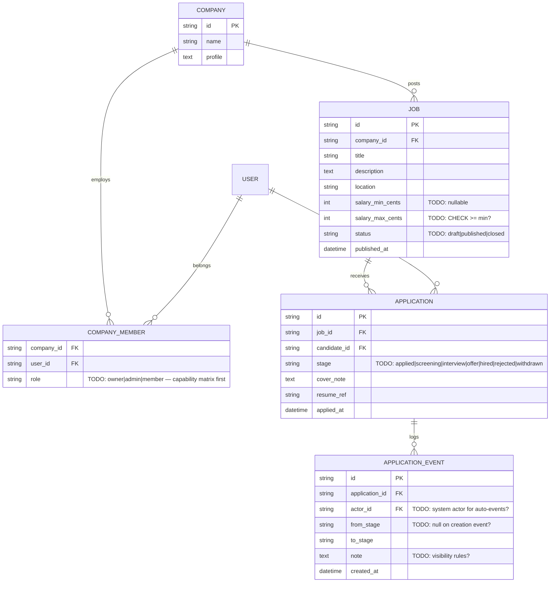

# 08 — Job Board with Roles

Difficulty ★★★★ · Focus: RBAC-shaped API design · 404 vs 403 · append-only audit events · visibility rules

Expected effort: two to three sessions. Builds on [07](07-ecommerce-orders.md) (auth patterns, error discipline). Carries project 03's auth forward for real.

## The brief

> "Companies post jobs; candidates apply. Company users — recruiters — manage their company's jobs and applicants. An application moves through stages: applied → screening → interview → offer → hired, or rejected from any stage. Every move records who did it and when, and the candidate sees that as a timeline on their application. Candidates see only their own applications. Recruiters of *other* companies see nothing of them — not even that they exist. Jobs can be drafts, visible only inside the company; published ones are public. A candidate can't apply twice to the same job and can't apply to a closed job. Applications carry a cover note and a resume (just a reference — file upload is out of scope). Months later, someone will ask 'who moved this application and when' — we must be able to answer exactly."

## Requirements (user stories)

1. Companies: create a company, edit its profile. Recruiters join a company (owner invites by email; invite token accepted → membership).
2. Jobs: draft / published / closed. Fields: title, description, location, salary range (min/max cents, optional). Only published jobs are visible to candidates; drafts only inside the company; closed jobs visible but not applicable.
3. Candidates (separate registration) apply to a published job: cover note + resume reference. Once per job. Closed job → error.
4. Recruiters move applications through the pipeline. Every transition appends an event: actor, from, to, timestamp, optional note. Rejection *requires* a note.
5. Candidate view: their applications + each one's timeline (the events, minus any internal-only notes? — decide).
6. Recruiter view: applicants for their company's jobs, filterable by stage and job, paginated.
7. **Isolation**: cross-company access to a job or application → `404`, byte-identical to "doesn't exist".
8. Candidate can withdraw an application — a terminal state.
9. Audit: full event history of an application, forever. Append-only — events are never edited or deleted.

## Design decisions to resolve

- **One users table or two?** Can a person be both a candidate and a recruiter? If yes: one `users` table with role-bearing *memberships* (project 09's shape); if no: simpler tables, harder later. Pick with the tradeoff stated.
- **`404` vs `403`** — argue it in your notes: a `403` confirms existence to someone who shouldn't know; `404` costs you nothing and leaks nothing. Commit to it *everywhere* in this project, including job drafts.
- **The event log** is the design centerpiece: `application_events(application_id, actor_id, from_stage, to_stage, note, created_at)`, append-only, no UPDATE/DELETE grants. Contrast with project 04: there balances were derived and unstored; here history *is* the product. The candidate timeline and the recruiter audit view read the *same rows* — or do they (see the internal-notes question)?
- **The pipeline as a state machine**: encode allowed transitions (`applied → screening | rejected`, `screening → interview | rejected`, …) — where? DB CHECK? Application code? Both? Rejection from *any* stage is legal; `hired` and `withdrawn` are terminal.
- **Duplicate applications**: `UNIQUE(job_id, candidate_id)` — but then withdrawn-then-reapply is impossible. Do you want that? (Options: allow reapply after withdrawal with a new row, or treat uniqueness as forever. Decide.)
- **Draft visibility** enforcement happens at *query* level (the candidate-facing list query never sees drafts) — not at response-filtering level. What's the attack that response-filtering invites? (Direct id access.)
- The resume is a reference string (`resume_ref`): model the reference, document the upload as out of scope. What's the format contract for the reference?
- Roles inside a company: `owner | admin | member`? What exactly may a mere member do (view applicants? move stages? edit jobs?)? Write the capability matrix before writing endpoints.

## Starter ERD



## Suggested API surface (react to it, don't obey it)

- Public/candidate: `GET /jobs` (published only, filters), `GET /jobs/{jobId}`, `POST /jobs/{jobId}/applications`, `GET /my/applications`, `GET /my/applications/{id}` (with timeline), `POST /my/applications/{id}/withdraw`
- Company: `POST /companies`, `POST /companies/{id}/invitations`, `POST /invitations/accept`
- Recruiter: `POST /companies/{id}/jobs` (draft), `GET /companies/{id}/jobs` (all statuses), `POST /companies/{id}/jobs/{jobId}/publish` / `/close`, `GET /jobs/{jobId}/applications?stage=`, `POST /applications/{id}/advance`, `POST /applications/{id}/reject`
- Audit: `GET /applications/{id}/events` (recruiter, full detail)

## OpenAPI skeleton

```yaml
openapi: 3.1.0
info:
  title: Job Board API
  version: 0.1.0
paths:
  /jobs/{jobId}/applications:
    get:
      # recruiter, same company only
      # TODO: ?stage=&limit=&cursor= — 404 if job is another company's (byte-identical
      #       to unknown job) — write that requirement into the description
      responses: {}
    post:
      # candidate applies — same path, different role & operation
      # TODO: 201 | 409 already_applied | 422 job_not_published | 422 job_closed
      #       — note: draft job for an outsider is 404, NOT 422. why? (document it)
      responses: {}
  /applications/{applicationId}/advance:
    post:
      # TODO: body {to_stage, note?} — 200 with application+event
      #       | 422 invalid_transition | 403 cross_company (member of another company)
      #       — and 404 if not a member of this company at all — why the difference?
      responses: {}
  /applications/{applicationId}/reject:
    post:
      # TODO: note REQUIRED here — 422 rejection_note_required
      responses: {}
  /my/applications/{applicationId}:
    get:
      # TODO: application + timeline; note visibility rules in the description
      responses: {}
components:
  schemas:
    Error: {}   # TODO: house envelope; define invalid_transition's details payload
```

## Gotchas to test

- Candidate requests another candidate's application id → `404`, identical to nonexistent.
- Recruiter from company B requests company A's draft job → `404`. Recruiter from company A → `200`. Byte-compare the 404s.
- `applied → hired` in one jump → `422 invalid_transition` (unless you allowed skips — say which).
- Reject without note → `422 rejection_note_required`. Reject twice → `409` or `422`?
- Two recruiters move the same application simultaneously (one advances, one rejects) — what serialized result is acceptable, and what enforces it?

## Self-review checklist

- [ ] The capability matrix (role × action) is written before the endpoints, and the endpoints match it.
- [ ] Every cross-boundary access is `404`, byte-identical to not-found — tested, not asserted.
- [ ] `application_events` has no update/delete path anywhere in the contract; the schema could revoke the grants.
- [ ] The stage machine's legal transitions are enumerable, and each illegal one maps to `422 invalid_transition`.
- [ ] Candidate timeline and recruiter audit come from the same events table — or your divergence (internal notes) is an explicit, documented rule.
