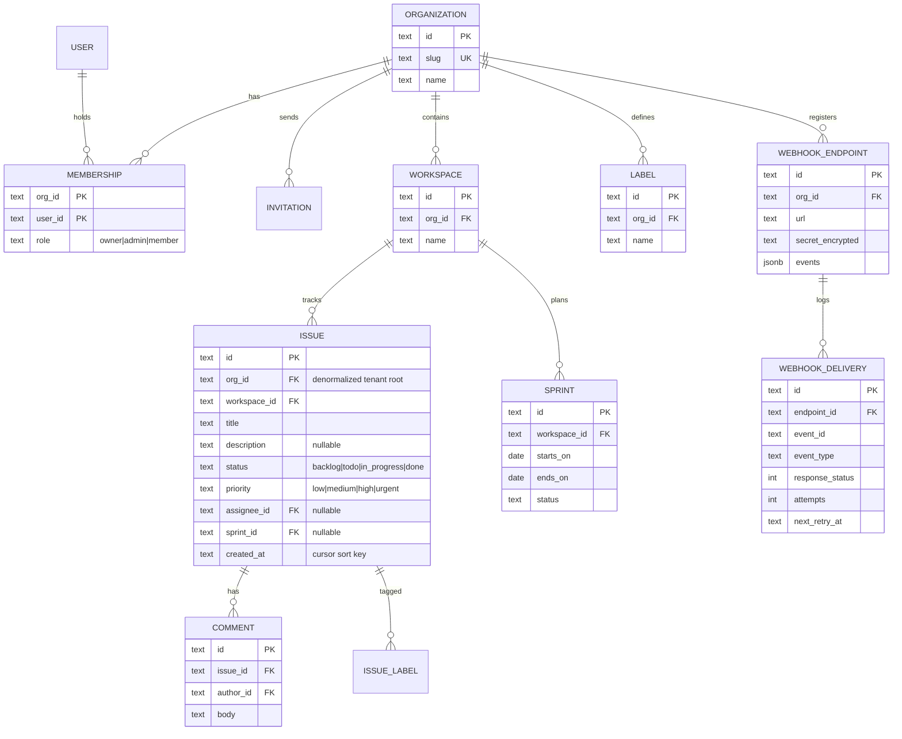

# 09 — Multi-tenant Project Tracker · Solution

> **Spoiler.** Commit first. The tenancy decision, the cursor format, and the webhook contract are what separate a demo from a platform here.

## Assumptions

1. **Tenancy: shared schema, `org_id` column on every tenant-owned table.** Every tenant index leads with `org_id` (or a tenant-scoped column like `workspace_id`, itself org-rooted). Rejected alternatives, with reasons: schema-per-org costs a migration × N tenants and connection-pool explosion; database-per-org is operationally heavier than this product warrants. Revisit at ~10⁴ orgs.
2. All paths carry the tenant: `/v1/orgs/{orgId}/...`. Auth middleware resolves the caller's membership in `{orgId}` **once per request**; non-members (even with valid tokens) get `404`, byte-identical to unknown org. In-scope, wrong role → `403 insufficient_role`; role matrix: `owner` = admin + billing/delete org; `admin` = invite/remove, webhooks; `member` = work issues.
3. Cursor pagination — fixed format for **every** list endpoint:
   - Cursor = opaque `base64("v1:" + created_at_iso + ":" + id)`.
   - Query: `WHERE ... AND (created_at, id) < (cursor_ts, cursor_id) ORDER BY created_at DESC, id DESC LIMIT :limit`.
   - The `id` tiebreak exists because `created_at` collisions are common at write bursts; without it, rows silently vanish between pages.
   - Garbage/expired cursor → `400 invalid_cursor` (never a silent restart — the client would double-import a page without knowing).
4. Rate limiting: **per token**, 600 requests/min, token bucket. Every response carries `X-RateLimit-Limit`, `X-RateLimit-Remaining`, `X-RateLimit-Reset` (unix seconds); exhaustion → `429` + `Retry-After`.
5. Webhook contract (the receiver-facing half of the API):
   - Envelope: `{ "id": uuid, "type": "issue.updated", "org_id": "...", "created_at": ..., "data": {...} }`.
   - Delivery: `POST` the customer's URL, JSON body, header `X-Signature: t=<unix>,v1=<hex hmac-sha256(secret, t + "." + body)>`.
   - **At-least-once, no ordering guarantees** — receivers dedupe by `id` and must tolerate reordering. Stated in the spec, not folklore.
   - Success = 2xx within 5 s. Retries: 1 min, 5 min, 30 min, 2 h, 6 h (5 attempts), then `failed`. Delivery log retained 30 days.
   - The secret is returned **once** at registration and stored encrypted (it must be usable for signing, so unlike passwords it cannot be hashed).
6. Versioning: paths carry `/v1/`. **Breaking** = removing/renaming a field, changing a type, adding a required request field, adding an enum value (exhaustive client switches break), changing error codes. **Non-breaking** = adding optional response fields, adding endpoints. Deprecations are signaled with `Deprecation: true` + `Sunset: <date>` headers and live ≥ 6 months.
7. Assignee invariant (`assignee must be an org member`) is enforced in the application transaction (a FK can't see across tables' tenant contexts) → `422 assignee_not_member`. When a member is removed, their issues are **unassigned** (stated; the alternative — blocking removal — contradicts admin workflows).

## Data model



## Schema (DDL — Postgres; every tenant index leads with the tenant)

```sql
CREATE TABLE organizations (
  id    UUID PRIMARY KEY DEFAULT gen_random_uuid(),
  slug  TEXT NOT NULL UNIQUE,
  name  TEXT NOT NULL,
  created_at TIMESTAMPTZ NOT NULL DEFAULT now()
);

CREATE TABLE memberships (
  org_id  UUID NOT NULL REFERENCES organizations(id) ON DELETE CASCADE,
  user_id UUID NOT NULL REFERENCES users(id)    ON DELETE CASCADE,
  role    TEXT NOT NULL CHECK (role IN ('owner','admin','member')),
  PRIMARY KEY (org_id, user_id)
);
CREATE INDEX idx_memberships_user ON memberships(user_id);

CREATE TABLE invitations (
  id         UUID PRIMARY KEY DEFAULT gen_random_uuid(),
  org_id     UUID NOT NULL REFERENCES organizations(id) ON DELETE CASCADE,
  email      TEXT NOT NULL,
  role       TEXT NOT NULL CHECK (role IN ('admin','member')),
  token_hash TEXT NOT NULL UNIQUE,
  status     TEXT NOT NULL DEFAULT 'pending',
  expires_at TIMESTAMPTZ NOT NULL
);

CREATE TABLE workspaces (
  id     UUID PRIMARY KEY DEFAULT gen_random_uuid(),
  org_id UUID NOT NULL REFERENCES organizations(id) ON DELETE CASCADE,
  name   TEXT NOT NULL
);
CREATE INDEX idx_workspaces_org ON workspaces(org_id);

CREATE TABLE issues (
  id           UUID PRIMARY KEY DEFAULT gen_random_uuid(),
  org_id       UUID NOT NULL REFERENCES organizations(id) ON DELETE CASCADE,
  workspace_id UUID NOT NULL REFERENCES workspaces(id) ON DELETE CASCADE,
  title        TEXT NOT NULL,
  description  TEXT,
  status       TEXT NOT NULL DEFAULT 'backlog'
               CHECK (status IN ('backlog','todo','in_progress','done')),
  priority     TEXT NOT NULL DEFAULT 'medium'
               CHECK (priority IN ('low','medium','high','urgent')),
  assignee_id  UUID REFERENCES users(id),
  sprint_id    UUID REFERENCES sprints(id),
  created_at   TIMESTAMPTZ NOT NULL DEFAULT now(),
  updated_at   TIMESTAMPTZ NOT NULL DEFAULT now()
);
-- every list the API offers, served by an index that starts at the tenant:
CREATE INDEX idx_issues_ws_cursor ON issues(workspace_id, created_at DESC, id DESC);
CREATE INDEX idx_issues_org_cursor ON issues(org_id, created_at DESC, id DESC);
CREATE INDEX idx_issues_assignee ON issues(org_id, assignee_id, status);

CREATE TABLE comments (
  id         UUID PRIMARY KEY DEFAULT gen_random_uuid(),
  org_id     UUID NOT NULL REFERENCES organizations(id) ON DELETE CASCADE,
  issue_id   UUID NOT NULL REFERENCES issues(id) ON DELETE CASCADE,
  author_id  UUID NOT NULL REFERENCES users(id),
  body       TEXT NOT NULL,
  created_at TIMESTAMPTZ NOT NULL DEFAULT now()
);
CREATE INDEX idx_comments_issue ON comments(org_id, issue_id, created_at);

CREATE TABLE sprints (
  id           UUID PRIMARY KEY DEFAULT gen_random_uuid(),
  org_id       UUID NOT NULL REFERENCES organizations(id) ON DELETE CASCADE,
  workspace_id UUID NOT NULL REFERENCES workspaces(id) ON DELETE CASCADE,
  starts_on    DATE NOT NULL,
  ends_on      DATE NOT NULL,
  status       TEXT NOT NULL DEFAULT 'planned' CHECK (status IN ('planned','active','closed')),
  CHECK (ends_on > starts_on)
);

CREATE TABLE labels (
  id UUID PRIMARY KEY DEFAULT gen_random_uuid(),
  org_id UUID NOT NULL REFERENCES organizations(id) ON DELETE CASCADE,
  name TEXT NOT NULL,
  UNIQUE (org_id, name)
);
CREATE TABLE issue_labels (
  issue_id UUID NOT NULL REFERENCES issues(id) ON DELETE CASCADE,
  label_id UUID NOT NULL REFERENCES labels(id) ON DELETE CASCADE,
  PRIMARY KEY (issue_id, label_id)
);

CREATE TABLE webhook_endpoints (
  id              UUID PRIMARY KEY DEFAULT gen_random_uuid(),
  org_id          UUID NOT NULL REFERENCES organizations(id) ON DELETE CASCADE,
  url             TEXT NOT NULL CHECK (url ~ '^https://'),
  secret_encrypted BYTEA NOT NULL,
  events          JSONB NOT NULL,             -- ["issue.created","issue.updated","comment.created"]
  created_at      TIMESTAMPTZ NOT NULL DEFAULT now()
);

CREATE TABLE webhook_deliveries (
  id              UUID PRIMARY KEY DEFAULT gen_random_uuid(),
  endpoint_id     UUID NOT NULL REFERENCES webhook_endpoints(id) ON DELETE CASCADE,
  event_id        UUID NOT NULL,              -- receivers dedupe on this
  event_type      TEXT NOT NULL,
  payload         JSONB NOT NULL,
  response_status INT,
  attempts        INT NOT NULL DEFAULT 0,
  next_retry_at   TIMESTAMPTZ,                -- NULL = done (delivered or failed)
  created_at      TIMESTAMPTZ NOT NULL DEFAULT now()
);
CREATE INDEX idx_deliveries_retry ON webhook_deliveries(next_retry_at) WHERE next_retry_at IS NOT NULL;
```

## API contract

### Endpoint map

| Method | Path | Success | Errors |
|---|---|---|---|
| POST | `/v1/orgs` | `201` (creator = owner) | `409 slug_taken` |
| GET/POST/DELETE | `/v1/orgs/{orgId}/members…` | `200/200/204` | `404` (non-member), `403 insufficient_role`, `409 already_member` |
| POST | `/v1/orgs/{orgId}/invitations` · `/v1/invitations/accept` | `201`/`200` | `410 invitation_expired` |
| GET/POST | `/v1/orgs/{orgId}/workspaces` | `200/201` | `404`, `403` |
| GET/POST | `/v1/orgs/{orgId}/workspaces/{wsId}/issues` | `200/201` | `404`, `422 assignee_not_member` |
| PATCH | `/v1/orgs/{orgId}/issues/{issueId}` | `200` | `404`, `422` |
| GET/POST | `.../issues/{issueId}/comments` | `200/201` | `404` |
| POST | `.../sprints/{id}/start` · `/close` | `200` | `409 sprint_already_active` |
| GET/POST/PATCH/DELETE | `/v1/orgs/{orgId}/webhooks…` | admin only | `404`, `403 insufficient_role` |
| GET | `/v1/orgs/{orgId}/webhooks/{id}/deliveries?limit=&cursor=` | `200` | `404`, `403` |

**Every response** (documented via a shared OpenAPI component) carries:

```
X-RateLimit-Limit: 600
X-RateLimit-Remaining: 417
X-RateLimit-Reset: 1761051600
```

`429` additionally carries `Retry-After` and the house error body with `code: "rate_limited"`.

### The webhook event, as published

```yaml
components:
  schemas:
    WebhookEvent:
      type: object
      required: [id, type, org_id, created_at, data]
      description: |
        Delivery is at-least-once and unordered: dedupe by id, tolerate reordering.
        Signature header: X-Signature: t=<unix>,v1=hex(hmac_sha256(secret, t + "." + raw_body)).
        Reject deliveries older than 10 minutes (t skew) to prevent replay.
        Retries: 1m, 5m, 30m, 2h, 6h; then delivery marked failed. Your endpoint
        must respond 2xx within 5 seconds — do work asynchronously.
      properties:
        id: { type: string, format: uuid }
        type: { type: string, enum: [issue.created, issue.updated, comment.created] }
        org_id: { type: string, format: uuid }
        created_at: { type: string, format: date-time }
        data: { type: object }
```

### OpenAPI (the load-bearing parts)

```yaml
openapi: 3.1.0
info:
  title: Tracker API
  version: 1.0.0
  description: |
    Versioning: breaking changes ship under a new /vN prefix. Breaking = removing
    or renaming a field, changing a type, adding a required request field, adding
    an enum value, changing an error code. Non-breaking = adding optional response
    fields, adding endpoints. Deprecations set Deprecation: true and Sunset: <date>
    and remain functional for at least 6 months.
paths:
  /v1/orgs/{orgId}/issues:
    get:
      description: |
        Cross-workspace issue list. Cursor pagination is uniform across all list
        endpoints: pass next_cursor back as cursor; opaque, versioned ("v1:").
        A garbage or stale cursor is 400 invalid_cursor — never a silent restart.
      parameters:
        - { name: status,    in: query, schema: { $ref: "#/components/schemas/IssueStatus" } }
        - { name: assignee,  in: query, schema: { type: string, format: uuid } }
        - { name: sprint,    in: query, schema: { type: string, format: uuid } }
        - { name: limit,     in: query, schema: { type: integer, default: 50, maximum: 100 } }
        - { name: cursor,    in: query, schema: { type: string } }
      responses:
        "200":
          content:
            application/json:
              schema:
                type: object
                required: [data, next_cursor]
                properties:
                  data: { type: array, items: { $ref: "#/components/schemas/Issue" } }
                  next_cursor: { type: [string, "null"] }
        "400": { description: invalid_cursor }
        "404": { description: Unknown org OR caller not a member — identical body }
  /v1/orgs/{orgId}/webhooks:
    post:
      requestBody:
        content:
          application/json:
            schema:
              type: object
              required: [url, events]
              properties:
                url: { type: string, format: uri, pattern: "^https://" }
                events: { type: array, items: { type: string, enum: [issue.created, issue.updated, comment.created] } }
      responses:
        "201":
          description: Registered. secret is shown ONCE — store it now.
          content:
            application/json:
              schema:
                type: object
                properties:
                  id: { type: string, format: uuid }
                  secret: { type: string }
        "403": { description: insufficient_role }
```

## Design decisions, answered

| Decision | Choice | Why |
|---|---|---|
| Tenancy strategy | Shared schema + `org_id`, tenant-leading indexes | One migration for all tenants; connection pooling stays sane. Schema-per-org wins only for hard per-tenant isolation/compliance demands this product doesn't have. |
| Tenant in path vs token-only | In path | Token-only tenancy makes URLs non-shareable, breaks per-org API keys (one token per org is a common ask), and hides the tenant from logs and rate counters. Path tenancy also makes the isolation check a single, testable middleware hop. |
| Cursor format | Opaque, versioned, `(created_at, id)` keyset | Offset pagination re-scans and row-jumps under concurrent inserts; keyset with a unique tiebreak is stable and index-served. Versioning the cursor (`v1:`) means the sort scheme can change without old cursors silently meaning something new. |
| Garbage cursor | `400 invalid_cursor` | A silent restart double-imports a page into the client's store; loud failure is the safe contract. |
| Rate limiting dimension | Per token | Scripts and CI are the callers that need the headers; orgs share the limit across their tokens' aggregate only if you decide so — stated: per token, not per org. |
| Webhook ordering | Explicitly unordered, at-least-once | Guarantees you can't keep (global ordering across retries) poison contracts. `id`-based dedupe + idempotent receivers is the honest platform deal. |
| Assignee invariant | App-level, in the write transaction | FKs can't verify membership across the tenant relationship; the check sits next to the write so no path skips it. |
| Member removal | Issues unassigned | Blocking removal breaks admin workflows for a data-preservation nicety; history (comments) stays attributed. |

## Back-of-the-envelope

- Scale: 500 orgs × 2 000 issues = **1M issue rows**. Cursor page of 50 = one index scan on `(workspace_id, created_at DESC, id DESC)` — depth-independent; page 1 and page 4 000 cost the same. (Offset at page 4 000 reads 200k rows to skip them — this is the concrete reason cursors won.)
- Webhooks: 10k registered endpoints × 50 events/day = 500k deliveries/day; with a 10% retry rate, the retry index `(next_retry_at) WHERE next_retry_at IS NOT NULL` stays small; 30-day retention bounds the table at ~15M rows ≈ 6 GB.
- Rate limiter: token bucket in memory (per process, behind a sticky LB) or one Redis hash per token — at 600 req/min per token, a Postgres-backed counter would be the bottleneck it's protecting against.
- Isolation testing: the same matrix approach as project 08 — role × resource × org, ~15 curls — plus the mid-pagination mutation test (insert + delete while paging 250 issues by 50).

## Gotchas, resolved

- **Cross-org probe** → `404` byte-identical to unknown org, on every path (middleware produces the body, so it *cannot* diverge).
- **Mid-pagination mutation** → cursor is `(created_at, id)` keyset: inserts land in later pages, deletes just shrink a page; no skips, no duplicates. Tested with a writer loop running during a 5-page walk.
- **Assignee left the org** → blocked on write (`422 assignee_not_member`); existing assignments cleared when the member is removed (decision 7).
- **Failing receiver** → delivery row: `attempts=1`, `next_retry_at=+1m`, … after 5 attempts `next_retry_at=NULL`, `response_status` of the last try preserved; visible in the deliveries endpoint.
- **Replay attack** → receiver rejects: signature covers the exact raw body + timestamp; ±10 min skew window documented.
- **`limit=500`** → clamped to 100 *and documented* (clamp vs 400 is a stated choice; clamping with a documented cap keeps naive clients working).

## Self-review bar

The tenancy tradeoff is written down with the rejection reasons; every tenant index leads with the tenant; the cursor format, tiebreak, and failure mode are specified once and used by every list endpoint; the webhook contract (envelope, signature, retries, dedupe, ordering) is *in the spec*; the versioning policy names what breaks.
