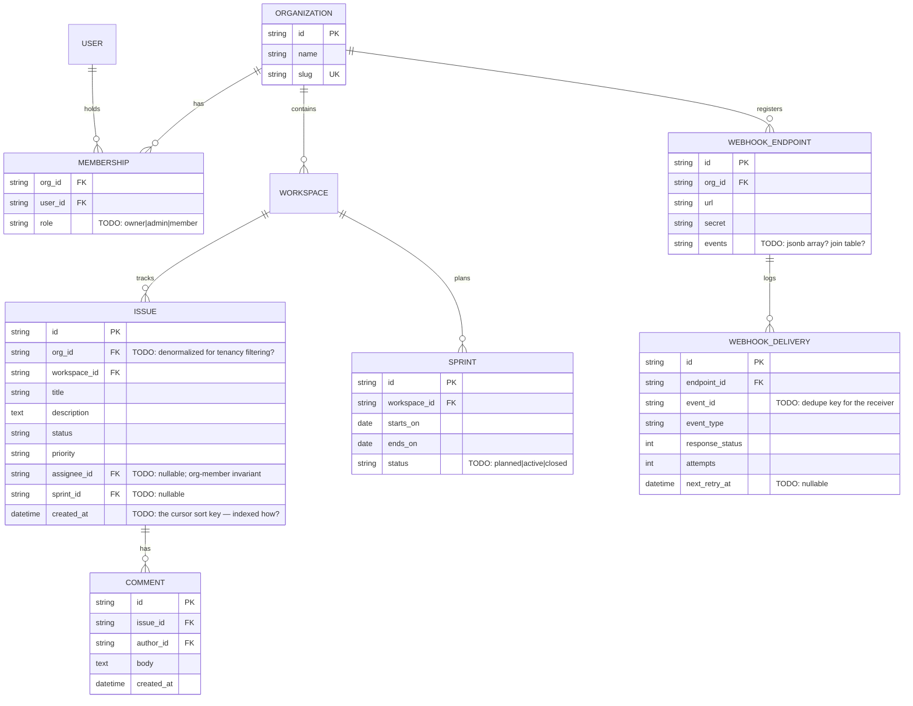

# 09 — Multi-tenant Project Tracker (Jira-lite)

Difficulty ★★★★★ · Focus: tenancy strategy · API versioning · cursor pagination at scale · rate limits · webhook contracts

Expected effort: three to four sessions. Builds on everything, especially [08](08-job-board.md) (roles, isolation). This is the shape of a real B2B SaaS API.

## The brief

> "A project tracker we sell to companies. A company — an organization — signs up; inside it there are workspaces; workspaces have issues; issues have comments, an assignee, a status, and can sit in a sprint. Members have roles: admins invite and remove people and manage webhooks; members just work issues. Every API path is scoped to an organization. And now we're a real platform: the API is versioned, list endpoints use cursor pagination because issues get big, requests are rate-limited with proper headers, and customers can register a webhook — an HTTPS endpoint that receives signed JSON when issues and comments change, with retries when they're down and a delivery log they can inspect. When we eventually deprecate a field, no customer's integration may break silently: versioning and deprecation are part of the contract from day one."

## Requirements (user stories)

1. Organizations: create; memberships with roles `owner|admin|member`. Invite by email → token → accept. Admins remove members.
2. Workspaces within an org. Issues within a workspace: title, description, status (`backlog|todo|in_progress|done`), priority, optional assignee, optional sprint, labels.
3. **Assignee must be a member of the org** — a constraint the FK alone can't express. Enforced somewhere, with a distinct error.
4. Comments on issues. `comment.created` is a webhook event.
5. Sprints: a date range; issues assigned to it; `start` and `close` actions.
6. Every list endpoint: **cursor pagination** — `?limit=50&cursor=...`, response `{ "data": [...], "next_cursor": "..." }`. The cursor is opaque.
7. Rate limiting: `X-RateLimit-Limit`, `X-RateLimit-Remaining`, `X-RateLimit-Reset` headers on every response; `429` with `Retry-After` when exhausted. (Simulate the limiter; the *contract* is the point.)
8. Webhooks: admins register an HTTPS URL + event subscriptions (`issue.created`, `issue.updated`, `comment.created`) + a signing secret. Deliveries are logged: event, response status, attempts.
9. Webhook contract: at-least-once delivery, no ordering guarantee, HMAC-SHA256 signature header with a timestamp to prevent replay. Retries with backoff. All of this is *documented in the spec* — it's part of the API.
10. Versioning: all paths under `/v1/`. The deprecation policy (what counts as breaking, how long deprecated fields live, the `Sunset` header) is written in the contract.

## Design decisions to resolve

- **Tenancy strategy** — the architectural decision of the project: `org_id` column on every row with composite indexes (shared schema) vs schema-per-org vs database-per-org. Write the tradeoffs (noisy neighbor, backups, migration cost, connection pooling) and commit. Every subsequent decision inherits it.
- **Where the tenant lives in the contract**: `/v1/orgs/{orgId}/workspaces/...`? Then *every* request resolves membership first — and a valid token from another org gets `404`, not `403` (you proved why in project 08). Who is allowed to use `/v1/workspaces/...` flat paths, if anyone?
- **Cursor pagination** — build it properly this time: the cursor is opaque (base64 of `sort_value + id`); ordering must be stable (`created_at, id` tiebreak — why does `created_at` alone break?); what happens when the client sends a garbage cursor (`400 invalid_cursor`, or start over — decide); why did offset pagination have to die? (Write the row-jump/deep-scan argument in your notes.)
- **Rate limiting dimensions**: per org? per token? per IP? Both bucket and headers go in the contract. What does a *batch* script integration need to see to back off politely?
- **The webhook envelope** is contract design at its purest: `{ "id": "...", "type": "issue.updated", "created_at": "...", "data": {...} }` — the `id` lets receivers dedupe (at-least-once!), the signature header spec (`X-Signature: t=...,v1=...`) prevents replays. Document the retry schedule. What does the receiver do when your retry arrives after they already processed attempt 1?
- **Versioning policy**: what changes are breaking (removing a field, changing a type, adding a *required* request field) vs safe (adding optional response fields)? How is deprecation signaled (`Deprecation`, `Sunset` headers)? One paragraph in the spec.
- Labels: a labels table + join, or a jsonb array on issues? (You answered this shape in project 01 — does the multi-tenant, filterable context change your answer?)

## Starter ERD



## Suggested API surface (react to it, don't obey it)

- `POST /v1/orgs`, `GET /v1/orgs/{orgId}`, membership: `GET/POST/DELETE /v1/orgs/{orgId}/members`, `POST /v1/invitations`, `POST /v1/invitations/accept`
- Workspaces: `GET/POST /v1/orgs/{orgId}/workspaces`, `GET/PATCH/DELETE /v1/orgs/{orgId}/workspaces/{id}`
- Issues: `GET/POST /v1/orgs/{orgId}/workspaces/{wsId}/issues`, `GET/PATCH /v1/orgs/{orgId}/issues/{issueId}`
- Comments: `GET/POST .../issues/{issueId}/comments`
- Sprints: `GET/POST .../sprints`, `POST .../sprints/{id}/start`, `/close`
- Webhooks: `GET/POST /v1/orgs/{orgId}/webhooks`, `PATCH/DELETE .../webhooks/{id}`, `GET .../webhooks/{id}/deliveries`

## OpenAPI skeleton

```yaml
openapi: 3.1.0
info:
  title: Tracker API
  version: 1.0.0
  description: |
    Versioning policy: breaking changes ship under a new /vN prefix.
    Deprecations are signaled with Deprecation and Sunset headers.
    Webhooks are at-least-once; receivers MUST dedupe by event id.
    # TODO: finish this paragraph — it IS the contract
paths:
  /v1/orgs/{orgId}/issues:
    get:
      # TODO: cross-workspace issue list with filters (status, assignee, sprint)
      #       cursor pagination params + response shape {data, next_cursor}
      #       400 invalid_cursor — or document your alternative choice
      responses: {}
  /v1/orgs/{orgId}/webhooks:
    post:
      # TODO: {url, events: [...]} → 201 with secret (shown ONCE — say so)
      # TODO: 422 unreachable_url? (do you probe? decide) | 403 not_admin
      responses: {}
components:
  schemas:
    WebhookEvent:
      # TODO: {id, type, created_at, data} — document at-least-once + no ordering
    Error: {}   # TODO: house envelope + rate_limited (429) shape
```

## Gotchas to test

- User from org B with a valid token hits `/v1/orgs/{orgA}/issues` → `404`, byte-identical to unknown org. Every path, every time.
- Page through 250 issues with `limit=50`; mutate the collection mid-pagination (insert + delete); the cursor must not skip or repeat. (This is why the tiebreak exists.)
- Assignee set to a user who *left* the org — blocked on write; but what happens to issues already assigned when the member is removed? (Decide: unassign? keep? The contract must say.)
- The delivery log shows a `500` receiver: retry scheduled with backoff, `next_retry_at` set, eventually marked failed. Simulate a failing receiver with a stub.
- Replay attack: a captured webhook body re-sent without the signature → receiver rejects. Document the exact HMAC input (timestamp + body, which encoding?).

## Self-review checklist

- [ ] Tenancy strategy chosen with tradeoffs written; `org_id` (or equivalent) appears in every tenant-owned table and in the critical indexes.
- [ ] Cursor format, sort key, and tiebreak documented; garbage cursor handled deliberately.
- [ ] Rate-limit headers + `429` shape on every response in the spec (a shared response component, not copy-paste).
- [ ] Webhook envelope, signature spec, retry schedule, and dedupe guidance are *in the spec*.
- [ ] Versioning + deprecation policy paragraph exists and names what's breaking.
