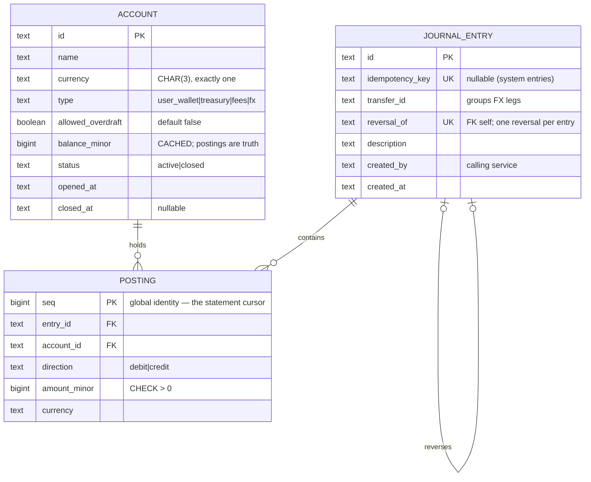

# 10 — Double-entry Ledger API · Solution

> **Spoiler.** Commit first. Here the schema *is* the correctness argument — immutability, the sum-zero invariant, and the concurrency discipline are the whole exam.

## Assumptions

1. Postgres. Consumed by **services**, not humans: every write requires `Idempotency-Key`; responses are machine-branchable (error `code` on everything).
2. **Postings are positive amounts + an explicit `direction`** (`debit|credit`), not signed values. Signed amounts make `SUM()` balances elegant but turn every audit query into "which sign convention was this account type using again?"; direction is self-describing in statements and events.
3. Balance convention: for user-facing accounts, `balance = Σcredit − Σdebit` (money you own is a credit). `balance_minor` is a **cached** column on `accounts`, maintained in the same transaction as the postings; `SUM(postings)` remains the truth, and `reconcile` compares the two.
4. **Nothing updates, ever**: `REVOKE UPDATE, DELETE` on all tables from the app role. Corrections are reversal entries. Reversals are **full-amount** — a partial correction is a reversal plus a new transfer (composable from two primitives you already have; a partial-reversal endpoint adds a state space for no capability).
5. Transfers between currencies go through a **per-pair FX position account**: transfer A(USD)→B(EUR) commits **two entries sharing one `transfer_id`** — (1) debit A / credit `fx:USD-EUR` in USD; (2) debit `fx:USD-EUR` / credit B in EUR, at the recorded rate. Each entry sums to zero per currency; the FX account accumulates the spread as its own auditable position.
6. Statements paginate by a **global** `postings.seq` (bigint identity): monotonic, gapless-per-commit (gaps from rollbacks are fine — monotonicity is what pagination needs), one cursor format for every account. The response is committed before the response is sent, so "never miss an entry" holds structurally.
7. Account close: no new activity may reference it (debit or credit); balance may be nonzero (real ledgers close with dust); closing is `POST /accounts/{id}/close`, never a mutation of status — closed is just a state checked at transfer time. (`status` column updated by the close endpoint is the one exception to "no updates" — the append-only rule guards *financial history*, i.e. entries and postings, which never update.)
8. Idempotency (project 06's mechanism, now guarding money): replay returns the original response; same key + different body → `422 idempotency_conflict`; concurrent duplicates race on the unique key, loser replays.

## Data model



## Schema (DDL — Postgres)

```sql
CREATE TABLE accounts (
  id               UUID PRIMARY KEY DEFAULT gen_random_uuid(),
  name             TEXT NOT NULL,
  currency         CHAR(3) NOT NULL,
  type             TEXT NOT NULL CHECK (type IN ('user_wallet','treasury','fees','fx')),
  allowed_overdraft BOOLEAN NOT NULL DEFAULT false,
  balance_minor    BIGINT NOT NULL DEFAULT 0,   -- cached; reconciled against postings
  status           TEXT NOT NULL DEFAULT 'active' CHECK (status IN ('active','closed')),
  opened_at        TIMESTAMPTZ NOT NULL DEFAULT now(),
  closed_at        TIMESTAMPTZ
);

CREATE TABLE journal_entries (
  id              UUID PRIMARY KEY DEFAULT gen_random_uuid(),
  idempotency_key TEXT UNIQUE,                  -- null only for system-generated legs
  transfer_id     UUID,                         -- groups the 1–2 entries of one transfer
  reversal_of     UUID UNIQUE REFERENCES journal_entries(id),
  description     TEXT NOT NULL,
  created_by      TEXT NOT NULL,                -- calling service identity
  created_at      TIMESTAMPTZ NOT NULL DEFAULT now()
);
CREATE INDEX idx_entries_transfer ON journal_entries(transfer_id);

CREATE TABLE postings (
  seq         BIGINT GENERATED ALWAYS AS IDENTITY PRIMARY KEY,
  entry_id    UUID NOT NULL REFERENCES journal_entries(id),
  account_id  UUID NOT NULL REFERENCES accounts(id),
  direction   TEXT NOT NULL CHECK (direction IN ('debit','credit')),
  amount_minor BIGINT NOT NULL CHECK (amount_minor > 0),
  currency    CHAR(3) NOT NULL
);
CREATE INDEX idx_postings_account ON postings(account_id, seq);
CREATE INDEX idx_postings_entry   ON postings(entry_id);

-- The invariant: every entry sums to zero per currency, checked at COMMIT
-- (deferred, so both legs of a two-entry FX transfer can be inserted first).
CREATE FUNCTION assert_entry_balanced() RETURNS trigger AS $$
DECLARE s BIGINT;
BEGIN
  SELECT COALESCE(SUM(CASE WHEN direction = 'credit' THEN amount_minor
                           ELSE -amount_minor END), 0)
    INTO s
    FROM postings WHERE entry_id = NEW.entry_id;
  IF s <> 0 THEN
    RAISE EXCEPTION 'entry % not balanced: delta %', NEW.entry_id, s;
  END IF;
  RETURN NULL;
END $$ LANGUAGE plpgsql;

CREATE CONSTRAINT TRIGGER trg_entry_balanced
  AFTER INSERT ON postings
  DEFERRABLE INITIALLY DEFERRED
  FOR EACH ROW EXECUTE FUNCTION assert_entry_balanced();

-- Immutability, mechanically enforced:
REVOKE UPDATE, DELETE ON accounts, journal_entries, postings FROM app_role;
```

**The transfer transaction** — locks ordered by account id (deadlock-free), funds checked atomically:

```sql
BEGIN;
  -- lock both accounts in a deterministic order (deadlock avoidance)
  SELECT id, balance_minor, allowed_overdraft, status, currency FROM accounts
   WHERE id IN (:debit_id, :credit_id)
   ORDER BY id FOR UPDATE;
  -- both active; currencies match (or FX path); debit account:
  --   balance - :amount >= 0 OR allowed_overdraft → else ROLLBACK 422 insufficient_funds
  INSERT INTO journal_entries (id, idempotency_key, transfer_id, description, created_by)
  VALUES (:entry, :key, :transfer, :desc, :service);
  INSERT INTO postings (entry_id, account_id, direction, amount_minor, currency)
       VALUES (:entry, :debit_id,  'debit',  :amount, :ccy),
              (:entry, :credit_id, 'credit', :amount, :ccy);
  UPDATE accounts SET balance_minor = balance_minor - :amount WHERE id = :debit_id;
  UPDATE accounts SET balance_minor = balance_minor + :amount WHERE id = :credit_id;
  -- idempotency row: INSERT ... ON CONFLICT (key) DO NOTHING → loser replays
COMMIT;
```

Note the two-account `UPDATE` of the cached balance is the *only* UPDATE in the system, and it moves money — it does not rewrite history.

## API contract

### Endpoint map

| Method | Path | Success | Errors |
|---|---|---|---|
| POST | `/accounts` | `201` Account | `422` |
| GET | `/accounts/{accountId}` | `200` (balance included) | `404` |
| POST | `/accounts/{accountId}/close` | `200` Account | `409 already_closed` |
| POST | `/transfers` — `Idempotency-Key` required | `201` TransferResult (+`200` replay) | `422 insufficient_funds`, `409 account_closed`, `422 currency_mismatch`, `422 missing_fx_rate`, `422 idempotency_conflict` |
| POST | `/entries/{entryId}/reversal` — idempotent | `201` ReversalResult | `404`, `409 already_reversed`, `422 reversal_of_reversal` |
| GET | `/accounts/{accountId}/balance` | `200` (cached; `?recompute=true` derives live) | `404` |
| GET | `/accounts/{accountId}/statement?cursor=&limit=` | `200` keyset page | `400 invalid_cursor`, `404` |
| POST | `/accounts/{accountId}/reconcile` | `200` ReconcileResult | `404` |

`TransferResult` for the FX case returns **both** entries and the rate used — the caller sees the full money movement it caused.

### OpenAPI (the load-bearing parts)

```yaml
openapi: 3.1.0
info:
  title: Ledger API
  version: 1.0.0
  description: |
    History is immutable: no endpoint updates or deletes anything; corrections are
    reversal entries. Balances are cached for speed; postings are the truth —
    reconcile compares them. All writes require an Idempotency-Key: replays return
    the original response; a reused key with a different body is a conflict.
paths:
  /transfers:
    post:
      parameters:
        - { name: Idempotency-Key, in: header, required: true, schema: { type: string, format: uuid } }
      requestBody:
        required: true
        content:
          application/json:
            schema:
              oneOf:
                - title: Same-currency
                  type: object
                  required: [debit_account_id, credit_account_id, amount_minor, currency]
                  properties:
                    debit_account_id:  { type: string, format: uuid }
                    credit_account_id: { type: string, format: uuid }
                    amount_minor: { type: integer, minimum: 1 }
                    currency: { type: string, minLength: 3, maxLength: 3 }
                    description: { type: string, maxLength: 200 }
                - title: Cross-currency
                  required: [debit_account_id, credit_account_id, amount_minor, currency, target_currency, fx_rate]
                  properties:
                    target_currency: { type: string, minLength: 3, maxLength: 3 }
                    fx_rate: { type: string, description: "decimal string, credit = amount × rate" }
      responses:
        "201":
          description: Committed. Entries included.
        "200":
          description: Idempotent replay of the original response
        "422":
          description: insufficient_funds | currency_mismatch | missing_fx_rate | idempotency_conflict
  /entries/{entryId}/reversal:
    post:
      parameters:
        - { name: Idempotency-Key, in: header, required: true, schema: { type: string, format: uuid } }
      responses:
        "201": { description: Mirrored entry; reversal_of set; original untouched }
        "409": { description: already_reversed }
  /accounts/{accountId}/statement:
    get:
      description: |
        Keyset pagination over the global postings sequence: cursor = last seq.
        Order is seq ASC; entries appear exactly once across pages even while
        transfers commit concurrently (committed rows are never missed because
        the seq is allocated at insert and the row is visible before the response).
      parameters:
        - { name: cursor, in: query, schema: { type: string } }
        - { name: limit,  in: query, schema: { type: integer, default: 100, maximum: 500 } }
      responses:
        "200":
          content:
            application/json:
              schema:
                type: object
                required: [data, next_cursor]
                properties:
                  data: { type: array, items: { $ref: "#/components/schemas/Posting" } }
                  next_cursor: { type: [string, "null"] }
  /accounts/{accountId}/reconcile:
    post:
      responses:
        "200":
          description: |
            matches=true means the cached balance equals SUM(postings). A mismatch
            is a bug alarm, not a state to self-heal: the response reports both
            numbers and the entry where they diverged (first seq after the split).
```

## Design decisions, answered

| Decision | Choice | Why |
|---|---|---|
| Direction column vs signed amounts | Direction + positive amounts | Self-describing audits; the sum-zero check is the only place sign arithmetic appears. Signed integers would make balances a one-liner and every human audit a puzzle. |
| Sum-zero enforcement | Deferred constraint trigger at COMMIT | App-only checks are bypassed by the first script that touches the DB. Deferred lets multi-leg entries (FX) be inserted before validation. |
| Balance: cached vs derived | Both, on purpose | Cached = O(1) hot reads and an atomic insufficient-funds check inside the transfer lock; derived = truth. `reconcile` exists precisely because the cache *can* drift — the design assumes its own failure and includes the detector. |
| Immutability | No UPDATE/DELETE endpoints + `REVOKE` at the DB | The grant matters: a buggy migration or psql session must be *unable* to rewrite history, not merely discouraged. |
| Reversal shape | Full-amount mirrored entry, `reversal_of UNIQUE` | One reversal per original (`UNIQUE`) makes "already reversed" a constraint, not a check. Partial corrections compose from reversal + new transfer. |
| Overdraft check | Inside the transfer lock, on the cached balance | The `FOR UPDATE` row lock serializes concurrent debits of one account; ordered locking (`ORDER BY id`) removes the deadlock. Optimistic retries don't fit a ledger: contention on hot accounts is the norm, not the exception. |
| Statement pagination | Global `postings.seq` keyset | One cursor format for all accounts; seq is allocated at insert (monotonic) and the row commits before the API responds — structural no-miss guarantee. Per-account sequences would need a counter table = a new hot spot. |
| Cross-currency | FX position account, two entries, shared `transfer_id` | Every entry stays single-currency and sum-zero — the invariant survives untouched. The FX account's nonzero balance *is* the auditable spread. |
| Idempotency | Shared key table (project 06's), request-hash conflict detection | Same mechanism everywhere; money just raises the stakes of the concurrent-duplicate race, which the unique key resolves. |

## Back-of-the-envelope

- Scale: 2M accounts, 50M postings/month ≈ **20/s average, 2k/s peak**. Posting row ≈ 120 B → **6 GB/month** of truth; partition `postings` by month when retention/archival begins (noted, not built).
- Statement page: `(account_id, seq)` index scan of 100 rows — O(log n + 100) at any depth; a 10-year-old account paginates as fast as a new one.
- Transfer cost: 2 row locks + 2 inserts + 2 updates ≈ 2–3 ms → a single Postgres node sustains ~1 000 transfers/s; beyond that, partition by account hash and route (the FX account becomes the only global — acceptable).
- The overspend race: 5 concurrent 100-unit debits of a 300-unit account → exactly 3 succeed, and `reconcile` reports `matches: true` afterward — the test that proves the locking order works.
- Trigger cost: one indexed aggregate over ≤ 2–4 rows per entry — noise at 2k/s.

## Gotchas, resolved

- **Overspend race** → 3 of 5 succeed; loser gets `422 insufficient_funds`; `SUM(postings)` still equals cached balances afterward.
- **Concurrent same-key transfers** → unique key: winner commits, loser reads the stored response — one entry, never two.
- **10.00 then reversed** → net balance zero, both entries visible forever, `reversal_of` links them, original untouched.
- **Currency mismatch without rate** → `422 currency_mismatch` (the API never invents a rate); with rate → two entries via `fx:USD-EUR`, both balanced, spread lands in the FX account.
- **Statement during live transfers** → no missed, no duplicated entries: seq is allocated at insert and committed before the response (tested with a writer loop during pagination).
- **Transfer involving a closed account** → `409 account_closed` whether debit or credit side (both checked; decision 7).
- **Reversal of a reversal** → `422 reversal_of_reversal` (reversal_of references entries, and the mirror-of-a-mirror is just a new transfer).

## Self-review bar

No UPDATE/DELETE anywhere — endpoints *and* grants; sum-zero lives in a deferred trigger and you can name what it catches; the overspend and idempotency races have executed tests; statement pagination's no-miss/no-dupe argument is written down; every failure is a machine code, because your callers are programs, not people.
