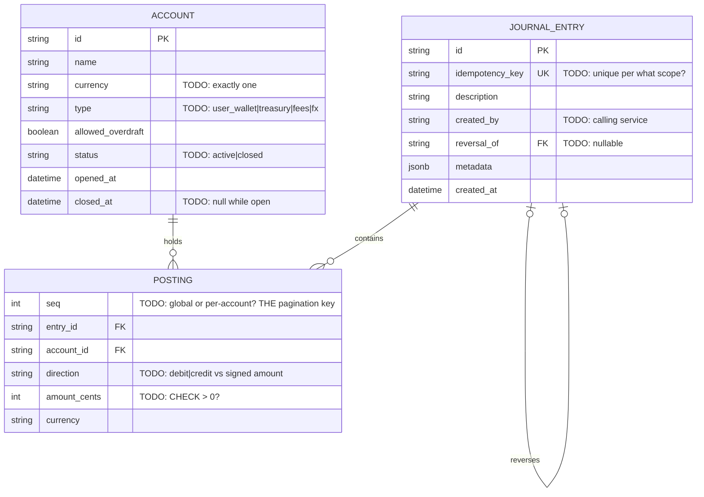

# 10 — Double-entry Ledger API

Difficulty ★★★★★ · Focus: immutability · double-entry invariants · idempotent writes · keyset pagination · reconciliation

Expected effort: three to four sessions. Builds on [06](06-event-ticketing.md) (idempotency) and [07](07-ecommerce-orders.md) (snapshots). The deep end: the schema *is* the correctness argument.

## The brief

> "The money core for a payments product. Money lives in accounts. Every movement is a transfer that debits one account and credits another by the same amount — never one without the other. Accounts and their history are append-only: nothing is ever updated or deleted; mistakes are corrected by reversal entries that reference the original, which stays exactly as it was. Each account holds one currency; a transfer between two currencies goes through an exchange, with both amounts recorded. Balances are what everyone argues about: they must always equal the sum of their entries — we reconcile, and the reconcile endpoint must be able to *prove* it. A transfer that would push an account below zero fails — unless the account is explicitly allowed to go negative. The API is consumed by other services: every write carries an idempotency key, and statements are read with keyset pagination over an immutable sequence number."

## Requirements (user stories)

1. Accounts: name, owner reference, currency, type (`user_wallet|treasury|fees|fx`…), `allowed_overdraft` flag. Open and close (close = no new activity — never delete).
2. Transfer: debit account, credit account, amount → one journal entry with **exactly two postings**. Requires an `Idempotency-Key`.
3. Invariant: postings of an entry sum to zero (within its currency). Enforced at the deepest layer you can manage.
4. Replaying the same idempotency key returns the same response — no second entry. Same key with a *different* payload → `422 idempotency_conflict`.
5. A transfer that would take an account below zero fails with `insufficient_funds` — except accounts with `allowed_overdraft`. The check and the write are atomic.
6. Reversal: creates a mirrored entry referencing the original (`reversal_of`). The original is untouched. Full or partial?
7. Balances per account — derived from postings. A `reconcile` endpoint compares the stored/cached balance (if you keep one) against `SUM(postings)` and reports mismatches.
8. Statement: entries affecting an account, keyset-paginated by a monotonic sequence number. The cursor is the sequence — never an offset.
9. Multi-currency: a cross-currency transfer records both amounts (and the rate). Simplest correct shape: two entries through an `fx` position account — or one entry with mixed-currency postings if you dare. Decide.
10. Audit: every entry records who (which service) created it and when. No mutation endpoints exist — not in the code, not in the spec, not even in the DB grants.

## Design decisions to resolve

- **The core shape** — argue it out: `journal_entries(id, idempotency_key UK, description, created_at)` + `postings(seq, entry_id, account_id, direction, amount_cents, currency)`. Signed amounts (`+5000/-5000`) vs a direction column? Trace both through the balance query and the sum-zero invariant.
- **The sum-zero invariant**: enforced by a DB trigger, a deferred constraint, application code — or all three? What's the first thing that corrupts if it's app-only? (Compare project 04, where you made the same call for shares.)
- **Balance: cached column or pure aggregation?** Fintechs keep *both*: a stored balance for speed and `SUM(postings)` as truth, with the reconcile endpoint comparing them. Decide whether you keep one, both, or derive-only — and write what breaks.
- **Immutability, mechanically**: no UPDATE/DELETE in the API; `REVOKE UPDATE, DELETE` at the DB level so even a bug can't rewrite history. Corrections are reversal entries — design the reversal's shape (mirror the postings? negate them?).
- **Concurrency**: two transfers debit the same account simultaneously — both must see consistent funds. Row locks ordered by account id (deadlock avoidance) vs serializable isolation; state your choice *and its deadlock/abort story*. The overspend race must be impossible, not unlikely.
- **The sequence**: global `BIGSERIAL` vs per-account sequence. Which one makes statement cursors monotonic and gapless *enough*, and what does "enough" mean for pagination correctness? (Write the argument: a client paginating by `seq > last_seen` must never miss an entry.)
- **Idempotency storage**: `(key, request_hash, response)` table — and the concurrent-duplicate race: both requests arrive with the same key; the UNIQUE constraint picks a winner; what does the loser get? (You designed this in 06 — here it guards money.)
- **Error codes** are the contract's vocabulary: `insufficient_funds`, `account_closed`, `currency_mismatch`, `idempotency_conflict`, `reversal_of_reversal`… Enumerate them before writing endpoints.

## Starter ERD



## Suggested API surface (react to it, don't obey it)

- `POST /accounts`, `GET /accounts/{accountId}`, `POST /accounts/{accountId}/close`
- `POST /transfers` — **`Idempotency-Key` required**; body: debit/credit account ids, amount, currency, optional fx rate
- `POST /entries/{entryId}/reversal` — idempotent too
- `GET /accounts/{accountId}/balance`
- `GET /accounts/{accountId}/statement?cursor=&limit=`
- `POST /accounts/{accountId}/reconcile` — or `GET /reconciliation?account=`; compare balance vs postings
- Note what's *missing*: no `PATCH /accounts/...`, no `DELETE /anything`. The absence is a spec decision — document it.

## OpenAPI skeleton

```yaml
openapi: 3.1.0
info:
  title: Ledger API
  version: 1.0.0
  description: |
    All writes are idempotent (Idempotency-Key required).
    History is immutable: no endpoint updates or deletes anything;
    corrections are reversal entries. Balances are derived from postings.
paths:
  /transfers:
    post:
      parameters:
        - name: Idempotency-Key
          in: header
          required: true
          schema: { type: string, format: uuid }
      # TODO: 201 {entry_id, postings} | 200 replayed
      #       | 422 insufficient_funds | 409 account_closed | 422 currency_mismatch
      #       | 422 idempotency_conflict (same key, different body)
      responses: {}
  /entries/{entryId}/reversal:
    post:
      # TODO: 201 mirrored entry with reversal_of set | 409 already_reversed
      #       — full or partial? your decision, in the description
      responses: {}
  /accounts/{accountId}/statement:
    get:
      # TODO: cursor = opaque encoding of (seq) — never offset; response {data, next_cursor}
      #       document: entries appear in seq order; the seq is immutable
      responses: {}
  /accounts/{accountId}/reconcile:
    post:
      # TODO: {matches: bool, stored_balance_cents, computed_balance_cents}
      #       — what does a mismatch MEAN if your invariants hold? (say it out loud)
      responses: {}
components:
  schemas:
    Error: {}   # TODO: house envelope; the error code enum is the contract's vocabulary
```

## Gotchas to test

- **The overspend race**: 5 concurrent transfers of 100 from an account holding 300. Exactly 3 succeed; `SUM(postings)` still reconciles afterward. Run it.
- **The idempotency race**: two identical transfer requests, same key, in parallel. One `201`, one coherent replay/conflict — never two entries.
- Transfer 10.00 then reverse it: net balance zero, both entries still visible, original untouched.
- Transfer between accounts of different currencies without an fx path → `422 currency_mismatch`. With the fx pattern: the fx account's position sums to the spread, not zero — how does your reconcile handle that?
- Paginate a statement while transfers are landing: no missed, no duplicated entries across pages.
- Close an account, then transfer from it → `409 account_closed`. Transfer *to* a closed account — same? Decide.

## Self-review checklist

- [ ] No UPDATE/DELETE anywhere: not in the API, not in the schema grants. Corrections exist only as reversals.
- [ ] Sum-zero is enforced below the app layer (trigger/constraint), and you can name what bypassing it would corrupt.
- [ ] The overspend race and the idempotency race both have *executed* tests, not arguments.
- [ ] Statement pagination is keyset over an immutable sequence, with the miss/duplicate argument written down.
- [ ] The reconcile endpoint defines what a mismatch means and what the response looks like when everything is right.
- [ ] Every error the API can return is in the code enum — a client can branch on your failures without parsing prose.
